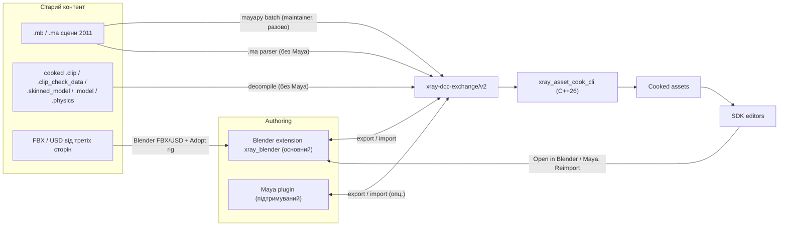
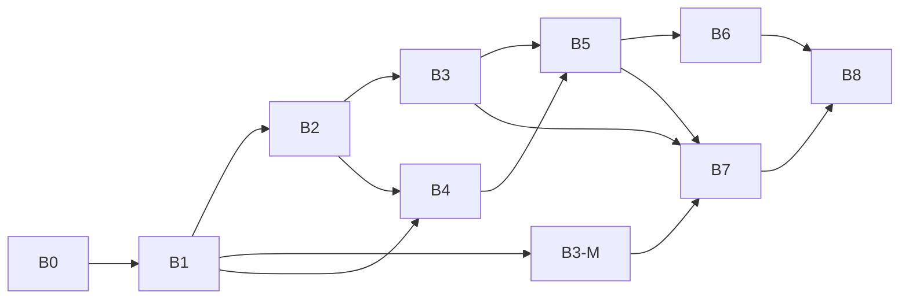

# План: Blender як основний DCC для X-Ray 2.0 SDK + автоматична міграція Maya-контенту

Дата плану: 2026-11-13. Статус: **B0–B8 та B3-M завершено й локально перевірено**; повний корпус 3836/3836 оброблено з діагностованими відмовами й погодженим винятком для 23 zero-root clips. Blender extension **0.3.2** містить гайд художника, імпортує exchange/legacy assets/basic MA без Maya; обидва DCC експортують v2, import/export/cook та engine playback contracts проходять. SDK integration, CI та B8 документацію перевірено на встановленому Blender 5.3.0. Відомі source/host failures збережено у прийманні. GitHub workflow підготовлено, віддалений запуск потребує налаштованого remote/runner; повний SDK8 лишається окремою роботою.

### Встановлений Blender 5.3 — перевірка 2026-11-15

За запитом користувача portable `build/blender/5.0.1/` та завантажений ZIP видалено. Поточний Windows host: `C:/Program Files/Blender Foundation/Blender 5.3/blender.exe`, версія **5.3.0**, build `02f0899d78e3`. CMake/SDK використовують встановлений host; runtime-lock 5.0.1 залишено як історичне походження попередніх перевірок.

Повторна перевірка проблемних випадків: **7/7** колишніх gimbal scenes, **93** exported Actions у native playback, максимальна похибка **0.000986291**; старі й нові `.blend` відкриваються. **23/23** zero-root clips залишаються `failed` з точною причиною Root.scale=(0,0,0), без repair і без підміни пози. Оригінали, B5 `.blend` та manifest незмінні. Release host contracts **5/5**, Debug Blender/SDK contracts **7/7**, SDK live reimport без перезапуску — PASS, Vulkan errors=0. Звіт: `build/blender-5.3-validation/result.json`; деталі кожного кліпу: `build/blender-5.3-validation/problem-animations-2/result.json`. Додаткове приймання B7 наведено нижче.

### Виконано 2026-11-13–14

- **B0:** pinned portable Blender **5.0.1**, офіційний SHA-256 і provenance у `build/blender/5.0.1/`; реальний headless contract slotted Actions проходить. [Runtime lock](sources/tools/blender/runtime-lock.json).
- **B0:** [інвентаризатор](sources/tools/blender/legacy_corpus.py) створив `build/blender-b0/legacy-corpus.json`; [lock](sources/tools/blender/legacy-corpus-lock.json) фіксує хеші й підсумки. Повний `C:/Stalker2_2011` містить **975 `.mb` + 5 `.ma`**, із них 25 `.mb` — у документації поза `xr2-dsgn/resources`; **347 кліпів і 346 check_data**. Один файл-копія не має check_data. Оригінали відкриваються лише для читання; неоднозначні зв'язки сцен не вважаються доведеними.
- **B0:** попередня оцінка `.blend` — 1–3× розміру сцен (~3–9 GB без packed textures). Це припущення для планування; канал постачання визначається після вимірів B4/B5.
- **B1, перший зріз:** [dcc_common](sources/tools/dcc_common/README.md) — writer/validator v1, cook bridge, constants, logical names. Maya використовує спільну реалізацію через сумісні адаптери. Додано `xray_asset_cook_cli`; `xray_maya_cook_cli` збережено.
- **B1, exchange v2:** [специфікація](sources/tools/dcc_common/SPEC_V2.md), `DccExchangeBundleWriter`, валідація `source_dcc`, осей і опційних редагованих `curves` у Python та C++. v1 writer зберігає свій формат за замовчуванням; обидва CLI читають обидві версії.
- **B1, осі:** C++ переводить Blender Z-up позиції/напрями, повні обертання, scale, bind pose, locators, clip TRS і physics; collision fitting повертає також source-space TRS. `mathutils` та справжня engine `create_rotation` перевіряють складені обертання, gimbal lock і переходи через ±π. Це exchange-контракти, а не готовий Blender scene exporter; `Rcorr` залишається частиною B3/B4.
- **B1, математика:** [animation_math](sources/xray/animation_math/README.md) — спільний portable fitter, value-owned `discrete_data`, завантаження legacy check data і перевірка семплів. `track_process.cpp` тепер компілює native engine API фітингу; `check_animation_data` виконує справжню перевірку замість заглушки. Активні animation consumers більше не залежать від Maya world/SISL; старий модуль лишено як архів для C++ Maya 2011 sources. UI редактора SDK-8 не входить до цього кроку.
- **B1, сумісність математики:** усі **346 `.clip_check_data`** прочитані й валідовані нейтральним loader без DCC host. Це не повна міграція/pose reconciliation B5. Порівняння до/після перенесення fitter дало **64 байтово ідентичні raw/converted файли** для п'яти типів v1 та v2; лог і fingerprints — `build/blender-b1-math/`.
- **B1, перевірки:** повна engine Debug-збірка — **13/13 PASS**, engine Release — **13/13 PASS**, standalone — **7/7 PASS**. Нові контракти перевіряють native engine playback, точність фітингу, часові offsets/fps, повторну обробку, additive-тип і діагностику помилок; Maya T1/T2, Blender headless, engine loaders та dependency/source contracts також проходять. `xray_engine` перелінковано в обох конфігураціях.
- **B2:** [xray_blender](sources/tools/blender/xray_blender/README.md) — extension manifest і GPL-3.0-or-later, preferences resources/cooker, меню/панелі **X-Ray 2.0**, створення body/collision/constraint Empties, static roots і locators; матеріали `xray_shader`/`xray_material`, armature `xray_axis_space`, body links і 6 DOF. Усі дані зберігаються в `.blend`.
- **B2, пакування:** [build_extension.py](sources/tools/blender/build_extension.py) створює самодостатній відтворюваний `build/blender/extension/xray_blender-0.1.0.zip` із потрібними модулями `dcc_common`, SHA-256 і per-member provenance. Штатна команда Blender `extension validate` проходить.
- **B2, перевірки:** `xray_blender_extension` реально встановлює ZIP в ізольований offline profile, перевіряє save/reopen у нових процесах, preferences, повторні register/unregister, збереження при вимкненому extension та rollback без перезапису конфліктної RNA-властивості. Standalone — **8/8 PASS**, engine Debug — **14/14 PASS**, Release extension contract — **1/1 PASS**. Логи й `.blend` приклад — `build/blender-b2/`.
- **B3:** [scene exporters](sources/tools/blender/xray_blender/exporters.py) — static, skeleton, skinned, animation і physics → exchange v2; export/cook operator, persistent settings, Action batches, additive flag, local center, precisions і evaluated Scene/NLA. Skin зберігає split normals/UV, застосовує top-4 normalized weights; modifiers і animation context відновлюються, зокрема після помилки. Один authored root, максимум 79 authored bones + `object_movement` = 80 tracks.
- **B3, рамки/physics:** експорт в armature space з explicit rig units, Y-up metadata та опційним зняттям визначеного `Rcorr`; bone-bound locators. `--fit-collision` створює editable helpers; auto-ragdoll створює rest-pose bodies, boxes і parent-linked joints. Геометричні collision/HQ collision та embedded/explicit joints підтримуються. Skeleton-family reconciliation лишається з importer/adoption у B4/B5.
- **B3, знайдені дефекти ядра:** flat-channel fitting тепер завжди дотримується precision (раніше міг вибрати перший sample замість midpoint при range між epsilon та 2×epsilon). Повторний cook зберігає float-типи відомих rigid-body settings, навіть коли Lua записує `0`/`1`; user values/material overrides збережено. Обидва випадки мають регресійні тести. Історичні byte-parity результати B1 вище стосуються стану до цих виправлень.
- **B3, перевірки:** `xray_blender_live` працює з установленим ZIP, реальними сценами й окремим процесом reopen; exchange/cooked bytes повторюються. Усі п'ять типів проходять engine loaders, **6 кліпів** — незалежне покадрове порівняння з Blender matrices у справжньому engine cubic playback. Top-4 із 5 influences, NLA/constraint, не-XYZ rotation mode, branching ragdoll, legacy frames, modifiers і негативні сцени перевірені. Standalone — **9/9 PASS**, Debug — **15/15 PASS**, Release — **15/15 PASS**; `xray_engine` перелінковано в обох конфігураціях. Логи та `.blend` fixture — `build/blender-b3/`.
- **B3, постачання:** відтворюваний `build/blender/extension/xray_blender-0.2.0.zip`, оновлений [гайд художника](sources/tools/blender/xray_blender/README.md). Подальше виправлення physics увійшло в 0.2.1 на B3-M.
- **B3-M, Maya v2:** frontend **2.1.0** напряму використовує `DccExchangeBundleWriter` для всіх п'яти типів і fit requests, записує `source_dcc: maya`, `right_handed_y_up`, `ccw`, source `frame_start` і явну root-motion policy. Collision fitting читає v2 `source`. Публічний legacy `ExchangeBundleWriter` лишається v1 за замовчуванням; імена команд, node IDs та обидва CLI збережено.
- **B3-M, паритет:** [xray_dcc_live_parity](sources/tools/dcc_common/PARITY.md) створює еквівалентні сцени в справжній Maya **2027** та встановленому ZIP Blender **5.0.1** — Y-up із `Rcorr` і native Z-up. П'ять кісток, jointOrient/різні Euler orders, top-4 із 5 influences, UV seams, неуніформні mesh transforms, locators, усі physics shapes, маси/links/6 DOF, standard та additive clip з рухомим local center. **12 порівнянь** (6 видів виходу × 2 Blender representations) проходять; **6 кліпів** перевірені покадрово в actual engine cubic playback. Для поточних Maya payloads v1/v2 headers дають **34 байтово ідентичні raw/converted файли**. Точності та межі fixture описані в PARITY.md; це не міграція всього корпусу.
- **B3-M, physics:** Blender тепер ставить root body та його unlinked metadata joint першими, незалежно від алфавітного порядку helpers: engine пропускає `joints[0]`, тому limb не губиться. Обидва frontend переводять linked authoring `rigid` у engine `fixed`, зберігаючи обидва bodies. Оновлений ZIP — `build/blender/extension/xray_blender-0.2.1.zip`; негативні сцени й root ordering мають тести. Maya T2 тепер застосовує явно заданий cooker після host startup, який може перевизначати environment.
- **B3-M, перевірки:** standalone **9/9 PASS**, Debug **16/16 PASS**, Release **16/16 PASS**, включно з попередніми Maya T1/T2 та Blender contracts. Логи й `.ma`/`.blend`/exchange/cooked fixtures — `build/blender-b3m/`, per-build parity artifacts — `dcc-parity/`. Опційний Maya exchange importer не був потрібен для B3-M; імпорт/decompile й corpus reconciliation — наступні B4/B5.
- **B4, нейтральний decompile:** [legacy_codec.py](sources/tools/dcc_common/legacy_codec.py) перенесено в `dcc_common`; старий Maya `reference_codec` — сумісний adapter із v1 defaults. Змішані Lua tables тепер зберігають numeric channels і `start_time`; `clip_check_data` є основним джерелом fps/precision/poses, `.clip` knots — seed-часами, spline sampling враховує fps/30. Додано перевірені 64-bit binary configs і converted model chunks поточного SDK, перевірки bounds/cycles VFS. V2 provenance `legacy_asset` позначає decompiled model/skeleton/physics; C++/Python валідатори оновлено.
- **B4, Blender import:** [importers.py](sources/tools/blender/xray_blender/importers.py), **File → Import → X-Ray / Maya ASCII**, окрема collection, rollback усіх нових datablocks і стану наявної арматури. Відновлюються armature/hierarchy, Mesh/UV/custom normals, weights, materials, locators і physics. Source fps/frame offset/count, additive/root policy і precisions зберігаються в Action. Per-bone correction зберігає також nonuniform bind scale; names/bind pose перевіряються. Логічні helper names не залежать від Blender suffixes.
- **B4, ключі/MA:** [ma_reader.py](sources/tools/dcc_common/ma_reader.py) читає базові TRS joints/transforms, animCurve з stored weighted/unweighted tangents, UV triangles/quads і direct skinCluster; MEL/scripts не виконуються. Складні references/IK/history/pivots явно потребують flatten або maintainer Maya route. [keyframes.py](sources/tools/blender/xray_blender/keyframes.py) переносить сумісні канали exact із handles/rotation order/infinity або робить editable key-preserving fit з seed-часів та покадровим reconciliation. У fixture реальної Maya **11 exact / 7 fit channels**, похибка поз ~`3.6e-7`; reader збігається з незалежними Maya curves/world matrices. Обмеження й workflow — [IMPORT.md](sources/tools/blender/IMPORT.md).
- **B4, оригінали:** новий neutral Python loader прочитав **346/346** оригінальних check-data files. Read-only animaxis skin/skeleton + base/additive clips пройшли import → export → cook → engine playback: **60 frames** на кліп, max pose error `<0.000003`, **67/114** editable keys замість dense bake. Це вибірка B4, не міграція 347 кліпів/980 сцен. Знайдені невідповідності skeleton families (зокрема weapon clip має додаткові joints щодо старого `ak_74.skeleton`) потребують B5 reconciliation; importer їх не вгадує.
- **B4, перевірки/постачання:** `xray_blender_import` працює з установленим ZIP без Maya paths, перевіряє всі п'ять raw/converted типів, exact keys/handles, native Z-up targets, save/reopen, late-failure rollback і **6 кліпів** у actual engine playback. Debug — **17/17 PASS**, Release — **17/17 PASS**, standalone — **10/10 PASS**. Відтворюваний `build/blender/extension/xray_blender-0.3.0.zip` байтово збігається з установленим ZIP import contract; штатний validator проходить. Артефакти/логи — `build/blender-b4/`. **Далі B5:** інкрементний migration runner, statuses/manifests, skeleton-family reconciliation і повна перевірка корпусу.
- **B4, відоме обмеження середовища:** у додаткових прогонах штатний headless installer Blender 5.0.1 іноді повертав `FINISHED` без доступного встановленого пакета. Причину не встановлено; це не позначено як виправлений дефект. Повторні чисті встановлення та п'ять послідовних Release extension contracts пройшли. Додано перевірку фактичного розпакування з installer diagnostics; невдалі логи збережено поруч з успішними, автоматичного retry у тестах немає.
- **B5, автоматизація:** [xray-migrate-legacy](sources/tools/blender/migrate_legacy.py), [інструкція](sources/tools/blender/MIGRATION.md) та атомарний manifest: source/dependency/tool/output SHA-256, процесне блокування workspace, resume без переписування незмінних `.blend`, repair пошкодженого output, retired sources. Оригінали перевіряються до/після; Maya відкриває лише робочі копії зі scripts disabled. References копіюються з інвентаризованого дерева; ізольовані native workers продовжують решту batch після crash окремої сцени. `--blender-workers` запускає паралельні Blender batches з окремими extension profiles; manifest пише лише coordinator після завершення кожного batch.
- **B5, ієрархії/ключі:** каталог містить реальні parent links із skeleton configs і Maya DAG, включно з дев'ятиканальним weapon family з `hud/test_wpn.mb`; збіг імен сам по собі не визначає сім'ю. Upstream controller/constraint seed times збережено; manifest містить direct/controller key counts, exact/fit і output keys per channel. Skin та animation використовують сумісну арматуру; різні bind poses отримують відповідні анімації зі збереженням первинного exchange. Окремий Maya → Blender тест порівнює деформовані vertices із незалежним Maya oracle.
- **B5, оригінальні моделі:** нейтральний reader підтримує VFS hard links з перевірками cycles/bounds і десяткові Lua escapes. Обмежене f32 округлення ваг документується; reserved root joint старої physics канонізується зі збереженням metadata. Settings-only `.model` використовують лише точний canonical `exported/models` counterpart, його SHA входить у dependencies. Відсутня геометрія отримує явний `failed`, без вигаданої підміни.
- **B5, точність:** повний корпус виявив adaptive fitter, який міг повернути результат за межами precision після досягнення ліміту control points. Спільний C++ fitter тепер перевіряє postcondition і за потреби використовує перевірену cubic Hermite interpolation; є regression та actual-engine tests із repeated knots. Engine migration verifier порівнює фізичні обертання, T/S і source precisions; scene-to-clip reconciliation окремо перевіряє кожну global joint pose і не вважає filename доказом відповідності.
- **B5, topology/resume:** повторені індекси у вироджених triangles реальних Maya/legacy meshes спричиняли native crash custom-normal setter Blender 5.0.1. Імпортер тепер вилучає такі triangles і перевіряє topology перед normals; vertex order, weights та UV збережено, repair counts записано в `.blend`/manifest, первинні indices — в exchange. Тест перевіряє UV/custom normals і незмінні vertex indices. Окремі SHA-verified receipts відновлюють завершені assets після втрати coordinator checkpoint; реальний Windows-reader test перевіряє bounded retry atomic replacement.
- **B5, root normalization:** аудит реальних Maya scenes виявив ще 7 анімацій, де старий gimbal threshold у C++ root-normalizer відкидав до ~0.009 rad обертання. `atan2` зі збереженням малої cosine-компоненти виправляє це. Новий physical-matrix regression падає до виправлення й проходить після нього; усі 7 реальних clips проходять actual engine playback, max error <0.001. Обидва CLI та Debug/Release/standalone перебудовано. Логи — `build/blender-b5/gimbal-before-fix.log`, `gimbal-after-fix.log`, `gimbal-replay.log`.
- **B5, regression checks (0.3.1):** Release — **20/20 PASS**, Debug — **20/20 PASS**, standalone — **11/11 PASS** на фінальному cooker. Нові contracts включають parallel workers, receipt recovery, Windows sharing, import/cook/playback, fresh reopen та незалежні Maya skin vertices. Логи — `build/blender-b5/ctest-release-gimbal-final.log`, `ctest-debug-gimbal-final.log`, `ctest-standalone-gimbal-final.log`. Відомий B4 installer flake у попередніх прогонах не позначено виправленим; невдалі логи збережено.
- **B5, повний корпус:** усі **3836/3836** записів мають кінцевий статус: **1317 migrated**, **2320 with_warnings**, **199 failed**. Створено **3291 `.blend`**, включно з **967** Maya source scenes; ще 346 записів — check-data companions. Оригінальний corpus SHA-256 збігається з B0 lock. Маніфест — `build/blender-b5/migration/migration-manifest.json`, редаговані сцени — `build/blender-b5/migration/resources/sources/blender/`.
- **B5, діагностика:** 199 failures включають 152 settings-only записи без canonical geometry, 11 source-каталогів лише з collision/settings без render geometry, 5 native Maya crashes, 3 сцени без підтримуваного вмісту, 2 missing-reference сцени, 2 rigs понад runtime bone limit, 1 duplicate-bone hierarchy та погоджені 23 zero-root clips. Успішні `.blend` зберігають warnings, repair counts, source provenance й ключі; часткових engine playback errors після gimbal fix немає. Шість записів, пропущених через headless installer flake, окремо повторено в уже встановлених profiles — усі 6 пройшли.
- **B5, без Maya/ієрархії:** [catalog](sources/tools/blender/legacy-skeleton-catalog.json) містить **5** доведених parent trees, що покривають усі 347 clips, із source SHA/evidence. Окремий cooked-only прохід без `mayapy` підтверджує **324** clips + **346** companions, решта 23 — погоджені failed. Legacy/Maya filename reconciliation залишає **247 range mismatches** і **100 no_candidates**: різні frame counts збережено, відповідність поз між цими джерелами не оголошено доведеною. Порівняння сумісних кандидатів і далі вимагає повної валідації бандлів та всіх global poses.
- **B5, ключі/обсяг:** звіти фіксують **686 exact** і **639241 fit** channels, **2890** source direct keys та **796176** upstream-controller keys; у збережених Actions — **10494469** editable keys. Це виміряна частка exact; числового приймального порога для неї не встановлено. Сукупний `.blend` output — приблизно **1.61 GB** без packed textures, з них Maya scenes — **1.23 GB**; канал постачання визначається на B6.
- **B5, фінальний resume:** **0 Blender jobs / 0 Maya jobs**, усі **3291** `.blend` зберегли mtime, усі **3836** статусів і corpus SHA залишилися незмінними. Часткових engine playback errors немає. Логи — `build/blender-b5/idempotent-gimbal-final.log`, `idempotent-gimbal-final-verify.log`; прийнятий zero-root policy та точні причини збережено в manifest. Далі — B6, інтеграція source/reimport у SDK.
- **Попередня перевірка v2:** standalone Release — **5/5 PASS**; engine Debug — **9/9 PASS**, включно з Maya T1/T2, engine contract та Blender headless із завантаженням усіх п'яти типів v2 через engine loaders. Логи й артефакти: `build/blender-b1-v2/`. Порівняння з cooker до v2 підтвердило байтову ідентичність усіх 32 raw/converted файлів п'яти тестових типів v1 (`v1-byte-regression.json`); v2 Y-up aliases та engine-space input також покриті byte-parity тестами.
- Команди відтворення середовища й перевірок: [Blender README](sources/tools/blender/README.md).

## 0. Прийняті рішення

| # | Питання | Рішення |
| --- | --- | --- |
| 1 | Maya для разової міграції `.mb` | Використовується на машині maintainer один раз. Користувачам SDK Maya **не потрібна** — див. розділ 5 «Користувач без Maya» |
| 2 | Доля Maya-плагіна | **Залишається повноцінно підтримуваним другим DCC.** Blender — основний (за замовчуванням), Maya — рівноправна альтернатива з тим самим форматом і тестами |
| 3 | Джерело правди | **`.blend`**. Exchange-бандли — проміжний формат (cache) + архівний знімок результату міграції, не редагуються вручну |
| 4 | Анімації | **З ключами**: перенесення оригінальних ключів animCurve, де це математично точно, і key-preserving fit із гарантованою похибкою там, де ні (розділ 4) |

## 1. Вихідні факти

| Що | Факт | Наслідок |
| --- | --- | --- |
| Поточний pipeline | Maya Python API 2.0 → `xray-maya-exchange/v1` (`manifest.json` + `payload.bin`) → C++26 `xray_maya_cook_cli` ([README.md](sources/tools/maya/README.md), [SPEC.md](sources/tools/maya/exchange/SPEC.md)) | Cooker і формат уже не залежать від Maya; потрібен другий frontend |
| Математика анімації | [skeletal_extractor.py](sources/tools/maya/plugin/skeletal_extractor.py#L340-L457) семплить матриці суглобів; [animation_cooker.cpp](sources/xray/maya_cook/sources/animation_cooker.cpp) фітить cubic B-spline з precision | Експорт з Blender теж семплює матриці → результат для engine не залежить від того, як зберігаються ключі |
| Decompile уже частково є | [reference_codec.py](sources/tools/maya/exchange/reference_codec.py) декодує `.model`, `.skinned_model`, `.skeleton`, `.clip`, `.physics` → exchange | Маршрут A будується на наявному коді |
| Exported кліпи | 347 `.clip` (текстовий Lua, B-spline knots) + `.clip_check_data` (покадрові дані, 30 fps, precision 0.005) | Переносяться без Maya, з точних семплів |
| Вихідні сцени | 975 `.mb` (Maya 2011, IFF `FOR4`) + 5 `.ma`; ~565 анімаційних сцен у `scenes/character/*/animation`, ~250 у `temp` | `.mb` надійно читає лише Maya → разова міграція maintainer |
| Engine | `xray/maya_animation` — внутрішня математика (discrete data, fitting, `check_animation_data`, animation editor `track_process.cpp`) | Перейменувати/відв'язати; залежність SDK-8 |
| Середовище | Maya 2027 (+MayaUSD) є; Blender не встановлено | Pinned portable Blender у `build/` → T2 завжди доступний у CTest |

## 2. Цільова архітектура

## 3. Ключові технічні рішення

1. **`xray-dcc-exchange/v2`** = v1 + `source_dcc` (`blender|maya|legacy_clip|legacy_ma|legacy_mb|legacy_asset`), канонічна система `right_handed_y_up` (аліас `maya_right_handed_y_up`) і `blender_right_handed_z_up`; нова опційна секція `curves` (ключі + tangents, лише для DCC import, cooker її ігнорує). v1 читається без змін. Перетворення осей — у C++ cooker (одне місце, покрите тестами).
2. **Простір арматури.** Атрибут арматури `xray_axis_space`:
   - `Y_UP_RH` — мігровані/Maya-рігі: дані арматури лишаються в оригінальному Y-up просторі й одиницях, а поворот +90° по X і масштаб одиниць задаються **на рівні об'єкта**. Так ключі переносяться без перерахунку осей;
   - `Z_UP_RH` — рігі, створені в Blender.
   Експортер працює в просторі арматури й оголошує відповідний `coord_space`.
3. **Рамки кісток.** Bone frame у Blender = рамка суглоба Maya × фіксована корекція `Rcorr` (signed permutation: вісь кістки Blender Y = вісь суглоба Maya X). Кістки виглядають правильно, а обертання лишаються **лінійними по каналах** (див. 4.1). Правило: в одній skeleton family одна конвенція рамок; експортер звіряє bind pose з еталоном family.
4. **Експорт анімації завжди семплюванням** (evaluated depsgraph, неперервний Euler) — працює з IK/constraints/NLA і не залежить від типу ключів.
5. **Blender API:** Extension (`blender_manifest.toml`), slotted actions/channelbags (`Action.fcurves` видалено в 5.0), pinned версія + шар сумісності.
6. **Ліцензія:** код з `bpy` — GPL-3.0-or-later; cooker — окремий процес, на нього не впливає.
7. **Maya як другий DCC:** спільний `dcc_common`, той самий exchange v2, однакові конвенції (`object_movement`, `locators`, physics-властивості), паритетні тести.

## 4. Перенесення ключів анімації

### 4.1 Режим `exact` (маршрут B і `.ma`, суглоби з прямими ключами)
Умови для кістки: `rotateAxis ≈ 0`, bind `rotate ≈ 0` (rest = jointOrient), ключі на самих суглобах.
- Обертання: у Blender `pose.rotation_euler` **точно дорівнює** каналам Maya `rotate`, переставленим/зі знаком через `Rcorr`; `rotation_mode` = відповідно переставлений Maya `rotateOrder`. Ключі, часи, tangents копіюються 1:1 (знак → дзеркалення значень і handles).
- Translation: лінійне перетворення `Rcorr⁻¹·JO⁻¹·(t − t_bind)`; точне, якщо ключі tx/ty/tz збігаються в часі, інакше — 4.2 для цієї кістки.
- Tangents Maya → Blender Bezier: in/out angle + weight → `handle_left/right` (`FREE`/`ALIGNED`), stepped → `CONSTANT`, linear → `LINEAR`, weighted/non-weighted, pre/post infinity → extrapolation / Cycles modifier. Час — кадри сцени при оригінальному fps; кутові одиниці — радіани.
- Scale: прямо по каналах (з урахуванням перестановки осей).

### 4.2 Режим `key-preserving fit` (усе інше)
Коли exact неможливий (ненульовий bind rotate, rotateAxis, ключі на rig-контролерах IK/constraints, маршрут A):
- Seed-часи ключів: оригінальні часи ключів (кістки або її контролерів у Maya; для маршруту A — knots B-spline з `.clip`).
- Значення — з baked покадрових даних, handles — з оцінки похідних; далі адаптивне додавання ключів, доки максимальна похибка ≤ precision кліпу (0.005) на кожному кадрі.
- Результат — редагована крива з мінімумом ключів, а не ключ на кожному кадрі.

### 4.3 Облік
`migration-manifest.json` для кожного кліпу/кістки: режим (`exact`/`fit`), кількість ключів до/після, max похибка проти bake, причина fallback (наприклад `ik_controller`, `bind_rotate`). Baked-семпли зберігаються в архівному exchange для валідації.

## 5. Користувач SDK без Maya

> [!IMPORTANT]
> Maya потрібна лише **один раз maintainer'у** для міграції 975 `.mb`. Результати (`.blend` + manifest) постачаються разом із ресурсами SDK, тому кінцевий користувач працює лише з Blender.

| Ситуація користувача | Що робить SDK |
| --- | --- |
| Оригінальний контент гри | Відкриває вже мігрований `.blend` (постачається з SDK) |
| Є лише cooked asset (`.clip`, `.skinned_model`, `.model`, `.physics`, `.skeleton`), напр. з мода | **Import legacy asset** у Blender через decompile — без Maya (маршрут A, ключі через 4.2) |
| Є `.ma` | Вбудований `.ma`-парсер (joints, transforms, animCurves, базовий mesh/skin) — без Maya |
| Є `.mb` і немає Maya | Пояснювальне повідомлення з варіантами: попросити автора експортувати `.ma`/FBX/USD; експериментальний `.mb` reader (best-effort, R&D, без гарантій) |
| FBX/USD від третіх сторін | Вбудований імпорт Blender + оператор **Adopt rig** (перейменування/мапінг кісток на skeleton family, `object_movement`, перевірка bind pose) |
| Користувач має Maya | Може працювати в Maya напряму (підтримуваний плагін) або сам мігрувати свої `.mb` тим самим `xray-migrate-legacy` |

## 6. Етапи

### B0. Середовище та корпус
- Pinned portable Blender у `build/blender/<version>/` (SHA-256, provenance).
- `legacy-corpus.json`: усі `.mb`/`.ma`/`.clip`(+check_data)/`.skeleton`/`.skinned_model` — шлях, розмір, SHA-256, класифікація, зв'язки «сцена ↔ exported clip»; оцінка розміру майбутніх `.blend` для вибору каналу постачання.
- **Готово:** корпус і Blender описані хешами; оригінал read-only.

### B1. DCC-нейтральне ядро (без зміни поведінки)
- `sources/tools/dcc_common/`: exchange writer/validator, cook bridge, constants, logical names; Maya-плагін переходить на нього.
- Схема v2 (`right_handed_y_up`, `blender_right_handed_z_up`, `source_dcc`, `curves`) у Python і C++.
- `xray_asset_cook_cli` + сумісне ім'я `xray_maya_cook_cli`.
- Engine: `maya_animation` → нейтральна назва, фітинг в animation editor через `bspline_fit.hpp`.
- **Готово:** усі Maya T1/T2 і engine contract tests проходять, cooked outputs еталонних сцен байтово ідентичні.

### B2. Blender extension — каркас і дані
- Preferences (resources path, CLI), меню/панелі **X-Ray 2.0**.
- Physics/locators як Empties з `PropertyGroup` (`xray_body`, `xray_collision`, `xray_constraint`, static-root marker, колекція `locators`); матеріали з `xray_shader`/`xray_material`.
- **Готово:** extension реєструється/знімається в `--background` без помилок.

### B3. Експортери Blender (паритет із Maya)
- Static, skeleton, skinned (≤80 кісток, top-4 weights), clip (standard/additive, local center, precisions, Action = clip, пакетний експорт), physics + `--fit-collision`, auto-ragdoll.
- **Готово:** кожен тип: export → cook → engine contract PASS; помилкові сцени дають зрозумілу діагностику.

### B3-M. Maya як підтримуваний другий DCC
- Maya-плагін на `dcc_common`/v2, ті самі конвенції; опційний exchange importer у Maya для обміну Blender ↔ Maya.
- **Готово:** паритетні тести Maya та Blender на однакових сценах дають еквівалентні cooked outputs.

### B4. Імпортери та decompile
- Decompile cooked assets → exchange на базі `reference_codec.py` (`.clip_check_data` як основне джерело семплів, `.clip` knots як seed-ключі, `.skinned_model`, `.model`, `.skeleton`, `.physics`).
- При підключенні check_data виправити `reference_codec.parse_lua_config`: змішані Lua tables (9 numeric channels + named `start_time`) зараз втрачають numeric entries у Python. Нейтральний C++ loader B1 вже читає цей варіант і named `data` без втрати семплів; корпус 346/346 перевірено.
- Blender importer exchange → Armature (п. 3.2–3.3), Mesh + vertex groups, Actions з ключами (секція `curves` або 4.2), physics Empties, матеріали.
- `.ma`-парсер → exchange (joints, animCurves з tangents, transforms, mesh/skin базово).
- **Готово:** import → export → покадрове порівняння TRS у межах precision для тестового набору; exact-ключі збігаються з оригінальними animCurve.

### B5. Автоматична міграція (`xray-migrate-legacy`)
Ідемпотентно, інкрементно за хешами, тільки в робочу копію, з `migration-manifest.json`.

| Маршрут | Джерело | Maya | Ключі |
| --- | --- | --- | --- |
| **A** | 347 cooked `.clip` + check_data + skeleton/skin | Ні | 4.2 (seed = B-spline knots) |
| **B** | 975 `.mb` + 5 `.ma` через `mayapy` + наявні extractors (+ експорт animCurve) | Так, разово (maintainer) | 4.1, fallback 4.2 |
| **C1** | `.ma` напряму | Ні | 4.1 / 4.2 |
| **C2** | `.mb` reader (R&D) | Ні | best-effort |

- Маршрут B: `maya.standalone`, `-ignoreVersion`, резолв references, лог відсутніх plugins/текстур; автовизначення вмісту; `temp`-сцени мігрують із позначкою.
- Reconciliation: для сцен з exported `.clip_check_data` результат B порівнюється з A — незалежна перевірка осей/рамок.
- Вихід: `resources/sources/blender/<відносний шлях>.blend` + архів exchange + manifest.
- **Готово:** 100% корпусу мають статус (`migrated`/`with_warnings`/`failed` + причина); усі 347 кліпів проходять legacy → Blender → export → cook → покадрове порівняння поз в engine у межах precision; ≥ узгодженої частки суглобових кривих перенесено в режимі `exact`.
- **Узгоджений виняток до 347/347:** користувач обрав залишити **23** старі navigation-test clips у `failed`: їхній `Root.scale=(0,0,0)` підтверджено в `.clip` і всіх **22** наявних check-data companions (одна копія companion не має). Підміна scale на одиничний змінює джерело поза precision, тому repair не виконано. Решта **324** проходять повний engine roundtrip, також в окремому запуску без Maya. Точну причину, source SHA і `retain_failed` policy записує [annotate_zero_root_failures.py](sources/tools/blender/annotate_zero_root_failures.py); це не результат 347/347.

### B6. Інтеграція в SDK

**Виконано 2026-11-15.** [SDK workflow](sources/tools/blender/SDK.md): Blender default / Maya alternative, associations і legacy import, Object/Action, відкриття master у DCC, manual Reimport та watcher, транзакційний live model reload і engine skeleton playback. Повний animation graph/retargeting editor залишається SDK8.

Приймання Release / Debug: native bound X 1.25 -> 3.75, engine pose delta 0.74999994 m, GPU readback 335 changed pixels, SDK restart=0, Vulkan errors=0. Детальні результати та межі: `sources/xray/editor/sdk_ui/dcc/acceptance.json`. Скасування, source races, відмова cook/commit, watcher, cache restore і `.mb` без Maya перевіряються в `xray_sdk_ui_compatibility`.

- Налаштування «DCC tool»: Blender за замовчуванням, Maya — вибір користувача.
- Model/animation editors (SDK-6/SDK-8): «Open source in Blender/Maya», «Reimport», «Import legacy asset», зв'язок asset ↔ `.blend` у resource browser, file watcher → re-cook → live reload; повідомлення для `.mb` без Maya (розділ 5).
- Оновити `sdk_migration_plan.md` і `function-matrix.json` (рядки `dcc-*`, Blender routes, Maya як альтернатива).
- **Готово:** зміна в Blender → Reimport → оновлений playback без перезапуску SDK.

### B7. Перевірка та CI

**Виконано й локально прийнято 2026-11-15.** [Єдиний runner](sources/tools/blender/run_ci.py), [команди/покриття](sources/tools/blender/CI.md), [приймання](sources/tools/blender/b7-acceptance.json), [GitHub workflow](.github/workflows/blender-ci.yml). Runner перевіряє CTest inventory, точний набір JUnit cases та відсутність skips; порожній або частковий suite не може дати PASS. Логи, host hashes та receipts зберігаються для кожного прогону; автоматичних повторів немає.

T1 без наявного Blender/Maya executable — **7/7**. Release CI — **22/22**, окремо чиста full engine збірка й CI — **22/22**; Debug із Maya OFF — **19/19**. Повний Release CTest — **29/29**. Maya AUTO без executable не реєструє жодного з трьох host tests, REQUIRED відмовляє з точною причиною; OFF перевірено зі старим cache. Workflow проходить actionlint. Git remote відсутній, тому GitHub run не запускався.

Zero-root regression перевіряє відмову без зміни payload, попереднього Action і scene datablocks; погоджені 23 corpus failures не ремонтуються. Один діагностичний no-Maya прогін мав `Blender worker exited 1 before completing this asset`; первинні worker logs тоді видалив temporary cleanup. Причину не встановлено: окремий діагностичний прогін і серія до першої відмови **5/5** успішні, фінальні CI також PASS. Додано збереження worker JSON/logs при майбутній відмові; початковий failed результат збережено й не зараховано як PASS.

- **T1** без DCC: конверсії осей/рамок, `Rcorr`/Euler-перестановки, tangents Maya → Bezier, fit з контролем похибки, схема v2, decompile/recook, `.ma`-парсер.
- **T2 Blender** (headless, завжди): `xray_blender_live` — експорт усіх типів, roundtrip, вибірка міграції.
- **T2 Maya** (якщо є `mayapy`): наявний suite + паритет із Blender.
- Окремий тест «користувач без Maya»: повний цикл A + C1 на машині без `mayapy` у PATH.

### B8. Документація

**Завершено 2026-11-15.** [Гайд художника](sources/tools/blender/xray_blender/README.md)
містить перший static export, rig/bind/units, materials і locators, Actions / NLA /
additive, exact/fit keys, physics, передачу в SDK та діагностику. [Maintainer
runbook](sources/tools/blender/MAINTAINER.md) описує випуск ZIP, sample/full
migration, resume, hashes, приймання warnings/failures і погоджену zero-root policy.
Оновлено [Blender README](sources/tools/blender/README.md), [Maya alternative](sources/tools/maya/README.md),
IMPORT/MIGRATION/SDK guides, CI navigation та function matrix.

Документаційний ZIP **0.3.2**, SHA-256
`f2e4fa7ddd952f3b70b33cf61624b0d79e6565a4a33f6d5ad0e0b79d52baa082`,
відрізняється від прийнятого 0.3.1 лише `README.md` і `blender_manifest.toml`;
Python members і старий ZIP незмінні. Перевірено посилання й 8 command entry
points, фінальний Release CI **22/22** та native SDK edit → Reimport → live GPU
model / engine animation без перезапуску, Vulkan errors=0. [B8 acceptance](sources/tools/blender/b8-acceptance.json)
містить hashes і фактичні результати.

Початкові B8 CI/SDK спроби зафіксували WinError 5 під час rename каталогу у
Blender ZIP installer. Failure logs збережено; окремий filesystem probe
підтвердив успішний rename через 100 ms без зміни ZIP/прав. Процес блокування
невідомий; фінальні прогони PASS не змінюють попередні failed результати.
Цю діагностику й ручне відновлення включено до інструкцій. Виправлення Blender
installer, запуск GitHub workflow і повний SDK8 не входять до приймання B8.

- Гайд художника (конвенції rig, `locators`, матеріали, Actions як кліпи, режими ключів), README Blender pipeline, README Maya як альтернативи, інструкція maintainer'а з міграції.

## 7. Порядок

Першим відчутним результатом буде маршрут A (B4 + частина B5): усі exported анімації в Blender із редагованими ключами, без Maya.

## 8. Ризики

- **`.mb` закритий:** без разового прогону maintainer'а неекспортовані сцени недоступні; C2 — лише best-effort.
- **Rig-контролери Maya** (IK/constraints/expressions) не переносяться як rig: суглоби отримують ключі в режимі 4.2. Перебудова rig у Blender (напр. Rigify + retarget) — поза межами плану.
- **Exact-режим** покриває лише суглоби з нульовими bind rotate/rotateAxis; частку визначить B0/B5 і зафіксує manifest.
- Maya 2011 → 2027: відсутні plugins/shaders, зламані references → статус `failed` із причиною, без мовчазного пропуску.
- Розбіжність рамок кісток між мігрованими і Blender-native рігами → валідація bind pose per family.
- Зміни Blender API → pinned версія, шар сумісності, T2 у CI.
- Розмір мігрованих `.blend` → канал постачання (у ресурсах SDK чи окремий пакет) вирішити за вимірами B0.

