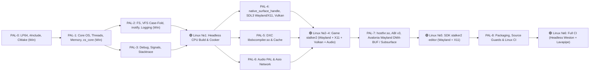

# План абстракції кодової бази X-Ray Engine 2.0 для адаптації під Linux (x86_64)

Цей план базується на статичному аудиті поточного стану репозиторію (`1289` активних одиниць компіляції у `compile_commands.json` пресету `windows-x64-release`, `38` `CMakeLists.txt` та всіх керованих проєктів `.NET 11 / Avalonia 12.2`).

Головна стратегія — **strangler fig (поступове витіснення Win32 на Windows без регресій)**: кожна фаза вводить чистий кросплатформений контракт (PAL — *Platform Abstraction Layer*), переводить активний Windows-код на нього та закріплює інваріанти тестами ще до першої збірки на Linux. У результаті сам порт на Linux зводиться до реалізації тонких, ізольованих `*_posix.cpp` / `*_linux.cpp` бекендів без масового переписування логіки рушія чи редактора.

> [!IMPORTANT]
> **Початкова готовність репозиторію вже висока:** рушій уже переведено на **GCC 16 + CMake 4.3+ + Ninja (C++26)**, **Vulkan 1.4 RHI**, **SDL3** (ввід і головне ігрове вікно), **Bullet**, **standalone Asio**, **Lua 5.5 + sol2**, **Boost**, **mimalloc**, **Ogg/Vorbis**, **zlib**, а весь SDK-інтерфейс працює на чистому **Avalonia 12.2 + `net11.0`** без WinForms, WPF, `Microsoft.WindowsDesktop.App` і C++/CLI.

---

## 1. Кількісний аудит поточного стану (активні цілі збірки)

### 1.1. Модулі, які вже майже або повністю незалежні від Windows

Ці цілі у [CMakeLists.txt](sources/CMakeLists.txt) не мають Windows-залежностей у CMake і мінімально (або зовсім не) торкаються Win32 API:

- `xray/ai`, `xray/ai_navigation`, `xray/animation`, `xray/animation_math`, `xray/particle`, `xray/physics`, `xray/rtp`, `xray/ui`, `xray/vfs`, `xray/maya_cook`
- `xray/editor/animation`, `xray/editor/sound`, `xray/editor/core` *(лише 1 P/Invoke у `SdkSoundCore.cs`)*, `xray/editor/avalonia_controls` *(лише `Win32NativeSurfaceHostBackend.cs` за інтерфейсом і опційний `AvaloniaWindowStyle.cs`)*
- `third_party/sol2`, `third_party/meshoptimizer`, `third_party/spirv_reflect`, `third_party/stb`, `third_party/wildmagic4`, `cs/script`, `opcode`

### 1.2. Модулі, що потребують абстракції (точна мапа Win32-зв'язності)

| Підсистема | Активні Windows-точки | Основні прив'язки до Win32 | Пріоритет / Фаза |
| --- | --- | --- | --- |
| **Збірка, типи, заголовки** | [CMakeLists.txt](sources/CMakeLists.txt), [macro_platform.h](sources/xray/macro_platform.h), [macro_compiler.h](sources/xray/macro_compiler.h), [type_extensions.h](sources/xray/type_extensions.h), [os_include.h](sources/xray/os_include.h) | Жорсткий guard `Windows only`, `17` backslash `#include`, `27` case-mismatch `#include` (`FastDelegate.h`), LP64-конфлікти (`std::uint64_t`, `long atomic32`, `DWORD`), `dllexport`/`dllimport`, `lua` `.dll.a` перевірка | **PAL-0** (Блокер) |
| **Ядро ОС (`xray/core`, `cs/core`)** | `18` файлів `*_win*.cpp` у [core/CMakeLists.txt](sources/xray/core/CMakeLists.txt) + `7` файлів у [cs/core/CMakeLists.txt](sources/cs/core/CMakeLists.txt) | `CRITICAL_SECTION`, `CreateEvent`/`HANDLE` (`event::get_handle`), `_Interlocked*`/`<intrin.h>`, `CreateThread`, `Tls*`, `QPC`/`timeBeginPeriod`/`winmm`, `VirtualAlloc`/`GlobalMemoryStatusEx`, `OpenClipboard`, `delayhlp.cpp`, `_controlfp`, `GetModuleFileNameW`, `shlwapi` | **PAL-1** (Фундамент) |
| **ФС, VFS, Watchers, Логи** | [fs/CMakeLists.txt](sources/xray/fs/CMakeLists.txt), `core/sources/fs_*_win*.cpp`, [resources_device_manager_thread_win.cpp](sources/xray/core/sources/resources_device_manager_thread_win.cpp), [logging_win.cpp](sources/xray/logging/sources/logging_win.cpp) | Два паралельні FS-шари (`xray/fs` і legacy `core/fs_*`), `CreateFile`/`OVERLAPPED`, `ReadDirectoryChangesW`, `_findfirst32i64`, `_sopen_s`, `PathRelativePathTo`, `path[1] == ':'`, `AllocConsole`/`WriteFile(GetStdHandle)`, відсутність нормалізації регістру на ext4 | **PAL-2** (Фундамент) |
| **Діагностика й аварії (`xray/debug`)** | [debug/CMakeLists.txt](sources/xray/debug/CMakeLists.txt) (`7` файлів) + [engine_world_file_system_device.cpp](sources/xray/engine/sources/engine_world_file_system_device.cpp) | `dbghelp` (`StackWalk64`, `SymInitialize`, `MiniDumpWriteDump`), SEH (`__try`/`__except`, `SetUnhandledExceptionFilter`, `AddVectoredExceptionHandler`), `SetThreadStackGuarantee`, `MessageBox`, `IsDebuggerPresent`, залишки `bugtrap_win.cpp` | **PAL-3** (Ядро) |
| **Вікна, Vulkan-поверхня, Ввід, Точка входу** | `37` заголовків із `HWND`, [engine_world_win.cpp](sources/xray/engine/sources/engine_world_win.cpp), [vulkan_platform_surface.cpp](sources/xray/render/vulkan/sources/vulkan_platform_surface.cpp), [vulkan_backend.cpp](sources/xray/render/vulkan/sources/vulkan_backend.cpp), [input_world_win.cpp](sources/xray/input/sources/input_world_win.cpp), [stalker2_pc_application_win.cpp](sources/xray/stalker2/pc/sources/stalker2_pc_application_win.cpp), [stalker2_pc_entry_point.cpp](sources/xray/stalker2/pc/sources/stalker2_pc_entry_point.cpp) | Протікання `HWND` через усі публічні ABI (`engine`, `render`, `input`, `game`, `editor`), прямий `vkCreateWin32SurfaceKHR` і `GetClientRect` у `vulkan_backend.cpp`, IPC через `GetPropA`/`SetPropA`, `WinMain` + `stalker2.rc` + Win32 splash dialog | **PAL-4** (Критичний шлях) |
| **Шейдери (DXC)** | [shader_compiler.cpp](sources/xray/render/core/sources/rhi/shader_compiler.cpp) | `windows.h`, `wrl/client.h` (`ComPtr`), `LoadLibraryExW("dxcompiler.dll")`, `MultiByteToWideChar`, UTF-16 `std::wstring` проти UTF-32 `wchar_t` на Linux | **PAL-5** (Рендер) |
| **Звук і Мережа** | [sound_world.h](sources/xray/sound/sources/sound_world.h), [voice_bridge.h](sources/xray/sound/sources/voice_bridge.h), [ogg_utils.cpp](sources/xray/sound/sources/ogg_utils.cpp), [platform_initializer_win.cpp](sources/xray/network/sources/platform_initializer_win.cpp), [SdkSoundCore.cs](sources/xray/editor/core/SdkSoundCore.cs), [SdkSound.cs](sources/xray/editor/base/SdkSound.cs) | `XAudio2.9` (`IXAudio2*`, `WAVEFORMATEX`, `ole32` COM) вплетений у `sound_world`/`voice_bridge`; `ws2_32` + `winsock_init` у `network`; `winmm.dll` (`PlaySound`, `waveOutGetNumDevs`) у C# | **PAL-6** (Аудіо/Мережа) |
| **Редакторський SDK (`hostfxr` + Avalonia C#)** | [managed_host.cpp](sources/xray/editor/world/sources/managed_host.cpp), [editor_entry_point.cpp](sources/xray/editor/world/sources/editor_entry_point.cpp), [host_bridge.h](sources/xray/editor/world/host_bridge.h), [engine_world_editor.cpp](sources/xray/engine/sources/engine_world_editor.cpp), [Win32NativeSurfaceHostBackend.cs](sources/xray/editor/avalonia_controls/Controls/Viewport/Win32NativeSurfaceHostBackend.cs), [SdkAvaloniaHost.cs](sources/xray/editor/base/SdkAvaloniaHost.cs), [EditorWorld.cs](sources/xray/editor/base/EditorWorld.cs) | `hostfxr.dll` + `wchar_t` (`char_t` на Linux — UTF-8 `char`), `xray_editor_world.dll`, `HWND` (1 handle) замість `(kind, handle, display)` для X11/Wayland, `PeekMessageW`/`SetThreadDpiAwarenessContext`/`dwmapi.dll` у C# | **PAL-7** (SDK) |
| **Тести, Пакування, CI** | [tests/CMakeLists.txt](sources/tests/CMakeLists.txt), [package-sdk-runtime.py](sources/tools/sdk/package-sdk-runtime.py), [test_source_contract.py](sources/tests/test_source_contract.py), [modernization-ci.yml](.github/workflows/modernization-ci.yml) | PE-аудит (`objdump -p`), `.exe`/`.dll` імена, `launch-sdk.cmd`, Windows-only CTest-контракти, відсутність `linux-x64` пресетів і GitHub Actions job | **PAL-8** (Верифікація) |

> [!NOTE]
> **Важливо щодо «сплячих» файлів на диску:** у `sources/xray/editor/world/sources/` на диску лежать спадкові файли 2011 року (`level_editor.cpp`, `material_effect.cpp`, `particle_editor.cpp` тощо з викликами `MessageBox`/`CreateDirectory`), але [editor/world/CMakeLists.txt](sources/xray/editor/world/CMakeLists.txt) компілює лише **4** файли (`editor_library_linkage.cpp`, `pch.cpp`, `editor_entry_point.cpp`, `managed_host.cpp`). Неактивні файли не повинні потрапляти в обсяг рефакторингу.

---

## 2. Критичні пастки LLP64 → LP64 та POSIX, виявлені під час аудиту

Ці дефекти негайно зламають збірку або призведуть до прихованого пошкодження пам'яті на Linux x86_64 (`sizeof(long) == 8`, чутлива до регістру ФС, ELF):

1. **Конфлікт `namespace std` у [type_extensions.h](sources/xray/type_extensions.h#L27-L36):** файл оголошує `typedef unsigned long long u64;` і повторно визначає `namespace std { typedef u64 uint64_t; }`. На Linux glibc/libstdc++ `std::uint64_t` є `unsigned long` — це дасть помилку компіляції в кожному TU, де підключено `<cstdint>`. **Рішення:** `#include <cstdint>` і визначити `u8..u64`/`s8..s64` через `std::uint8_t..std::uint64_t`.
2. **Некоректний розмір 32-бітних атомарних типів:** у [threading_functions.h](sources/xray/threading_functions.h#L27) (`typedef long atomic32_value_type;`) та `xray/debug/sources/utils.h:77` (`typedef long atomic32;`) використано `long`. На Linux x86_64 це **64 біти** замість 32, що зламає `union { atomic32_type m_atomic; float m_val; }` у [sound_world.h](sources/xray/sound/sources/sound_world.h#L67-L70) та інші структури! Аналогічно `typedef unsigned long DWORD;` у [debug.h](sources/xray/debug.h#L55) та `xray/debug/debug.h:79` має стати `u32` (або бути прибраним із кросплатформенних заголовків).
3. **Регістр та слеші в `#include`:** виявлено **17 директив** із `\` (зокрема `xray/physics/sources/collide_element.cpp` — активний файл!) і **27 директив** із невідповідністю регістру (критично: `fastdelegate/fastdelegate.h` проти реального файлу `fastdelegate/FastDelegate.h` у 22+ заголовках ядра й рендера).
4. **Реентрантність `CRITICAL_SECTION`:** Windows `CRITICAL_SECTION` у [threading_mutex_win.cpp](sources/xray/core/sources/threading_mutex_win.cpp) є **рекурсивним**. Пряма заміна на звичайний `std::mutex` або `PTHREAD_MUTEX_NORMAL` на Linux призведе до deadlock у місцях повторного захоплення тим самим потоком. Для `mutex_tasks_unaware` на POSIX потрібно використовувати `PTHREAD_MUTEX_RECURSIVE` (`sizeof(pthread_mutex_t) == 40` байт на x86_64 glibc — точно вміщується у наявний `u64 m_mutex[5]`).
5. **Обмежений буфер `event_tasks_unaware` (`sizeof(pvoid) == 8` байт) і `get_handle()`:** у [threading_event.h](sources/xray/threading_event.h#L24-L27) закладено розмір Win32 `HANDLE` (`8` байт), а `get_handle()` протікає у `OVERLAPPED.hEvent` у трьох місцях (`resources_device_manager_thread_win.cpp`, `folder_watcher.cpp`, `stalker2_pc_application_win.cpp`). На Linux `event` реалізується без heap-алокації через `futex` (`std::atomic<u32>`, 4 байти) або через розширений inline-буфер під `pthread_mutex_t + pthread_cond_t`, а `get_handle()` має стати Win32-приватним.
6. **Один `HWND` недостатній для Linux Vulkan-поверхні у SDK:** на Windows `vkCreateWin32SurfaceKHR` бере лише `HWND` (бо `HINSTANCE` береться з `GetModuleHandle(nullptr)`). На Linux для вбудованої поверхні Avalonia потрібна **пара** `(display_connection, native_window)`: `(Display*, Window)` для Xlib, `(xcb_connection_t*, xcb_window_t)` для XCB або `(wl_display*, wl_surface*)` для Wayland.

---

## 3. Цільова шарувата архітектура (PAL)

```mermaid
flowchart TD
    subgraph AppLayer["Прикладний шар (100% OS-agnostic)"]
        Game["xray_game / stalker2 / ai / animation / physics / ui"]
        EditorCore["xray.editor.core + xray.editor.avalonia_controls (net11.0)"]
        RenderCore["xray_render_vulkan (pipeline, materials, compute skinning, LOD)"]
        SoundCore["xray_sound (scenes, streaming, Ogg/Vorbis, panning LUT, SPL)"]
    end

    subgraph PAL["Платформені контракти (PAL — стабільні інтерфейси)"]
        OsPal["xray::os (dynlib, paths, env, vmem, fp_ctrl, process, clipboard)"]
        ThreadPal["xray::threading (atomic_ref, mutex, event, thread, TLS, clock)"]
        FsPal["xray::fs_new::device_file_system_interface + i_folder_watcher"]
        DebugPal["xray::debug::platform (protected_call, call_stack, crash_report)"]
        SurfacePal["native_surface_handle + surface_adapter + capture_control_bus"]
        AudioPal["xray::sound::i_audio_backend + i_audio_voice"]
        ShaderPal["xray::render::rhi::i_shader_compiler"]
        HostPal["host_bridge ABI v3 + INativeSurfaceHostBackend + IPlatformUiServices"]
    end

    subgraph WinImpl["Windows x64 бекенди (існуюча поведінка)"]
        WinOs["*_win.cpp (Win32, DbgHelp, ReadDirectoryChangesW)"]
        WinAudio["XAudio2.9 + WinMM"]
        WinSurf["SDL3 + VK_KHR_win32_surface + Win32NativeSurfaceHostBackend"]
        WinHost["hostfxr.dll + dxcompiler.dll"]
    end

    subgraph LinImpl["Linux x86_64 бекенди (нова реалізація)"]
        LinOs["*_posix.cpp / *_linux.cpp (pthread, futex, mmap, inotify, sigaction, libbacktrace)"]
        LinAudio["SDL3 Audio / OpenAL Soft"]
        LinSurf["SDL3 (Wayland/X11) + VK_KHR_wayland/xlib/xcb_surface + Offscreen DMA-BUF / Wayland Subsurface"]
        LinHost["libhostfxr.so + libdxcompiler.so"]
    end

    Game --> OsPal
    Game --> ThreadPal
    Game --> FsPal
    Game --> SurfacePal
    RenderCore --> SurfacePal
    RenderCore --> ShaderPal
    SoundCore --> AudioPal
    EditorCore --> HostPal

    OsPal --> WinOs
    OsPal --> LinOs
    ThreadPal --> WinOs
    ThreadPal --> LinOs
    FsPal --> WinOs
    FsPal --> LinOs
    DebugPal --> WinOs
    DebugPal --> LinOs
    SurfacePal --> WinSurf
    SurfacePal --> LinSurf
    AudioPal --> WinAudio
    AudioPal --> LinAudio
    ShaderPal --> WinHost
    ShaderPal --> LinHost
    HostPal --> WinHost
    HostPal --> LinHost
```



---

## 4. Поетапний план абстракції (`PAL-0` — `PAL-8`)

Послідовність побудована так, щоб **фази `PAL-0` — `PAL-7` повністю виконувалися й перевірялися на поточному Windows x64 CI** без зламу жодного існуючого сценарію, а підключення Linux-бекендів відбувалося інкрементально, починаючи з `xray_asset_cook_cli` і CPU-тестів уже після `PAL-3`.

### Фаза PAL-0. Гігієна заголовків, типів LP64, макросів і CMake ✅ Виконано
*Мета: усунути синтаксичні, препроцесорні та ABI-блокери компіляції під GCC/Clang на Linux x86_64.*

> **Компіляція:** Windows x64 (✅ виконано: `1430/1430` кроків, `19/19` CPU). Компіляція на Linux ще не виконується (POSIX-бекенди додаються в PAL-1 — PAL-3).

- [x] **Нормалізація `#include`:**
  - Замінити всі `17` `#include` зі зворотним слешем `\` (зокрема `xray/physics/sources/collide_element.cpp`) на `/`.
  - Виправити всі `27` невідповідностей регістру (передусім `fastdelegate/fastdelegate.h` → `fastdelegate/FastDelegate.h` у `22+` заголовках, `DelayImp.h` → `delayimp.h`, `DX10_defines.h`/`DX11_defines.h`).
  - Додати автоматичну перевірку заборони `\` і case-mismatch у [test_source_contract.py](sources/tests/test_source_contract.py).
- [x] **Виправлення LP64-типів і `namespace std`:**
  - Переписати [type_extensions.h](sources/xray/type_extensions.h) поверх `#include <cstdint>` (`typedef std::uint64_t u64;` тощо), прибравши UB-перевизначення всередині `namespace std`.
  - Замінити `typedef long atomic32_value_type;` у [threading_functions.h](sources/xray/threading_functions.h#L27) і `typedef long atomic32;` у `xray/debug/sources/utils.h` на `s32` (додати `static_assert(sizeof(atomic32_value_type) == 4)`).
  - Прибрати глобальний `typedef unsigned long DWORD;` із не-Windows гілки у [debug.h](sources/xray/debug.h#L53) та `xray/debug/debug.h` (ізольовано під `#if XRAY_PLATFORM_WINDOWS` разом із `unhandled_exception_filter`).
- [x] **Платформені та компіляторні макроси:**
  - Розширити [macro_platform.h](sources/xray/macro_platform.h): визначити `XRAY_PLATFORM_WINDOWS` (`0`/`1`), `XRAY_PLATFORM_LINUX` (`0`/`1`), `XRAY_PLATFORM_POSIX` (`0`/`1`), `XRAY_PLATFORM_64_BIT` (`1`), замість жорсткого `#error` при `!defined(_WIN64)` (вимагати 64-бітну архітектуру x86_64/arm64).
  - Оновити [macro_compiler.h](sources/xray/macro_compiler.h):
    - для ELF (`!XRAY_PLATFORM_WINDOWS`): `XRAY_DLL_EXPORT` = `__attribute__((visibility("default")))`, `XRAY_DLL_IMPORT` = порожньо;
    - прибрати глобальне `#define _stdcall __stdcall` / `_cdecl` / `_fastcall` на не-Windows (додати `XRAY_STDCALL` / `XRAY_CDECL` / `XRAY_FASTCALL` — порожні на Linux x86_64);
    - додати `XRAY_SHARED_LIB_PREFIX` (`"lib"`), `XRAY_SHARED_LIB_SUFFIX` (`".dll"` / `".so"`), `XRAY_EXE_SUFFIX` (`".exe"` / `""`).
  - Оновити [platform_extensions.h](sources/xray/platform_extensions.h) (`platform_name()` повертає `"windows"` або `"linux"`).
  - Розділити [os_raii_win.h](sources/xray/os_raii_win.h): перенести кросплатформений `scoped_cleanup` у [os_raii.h](sources/xray/os_raii.h), залишивши `unique_handle` / `com_ptr` під `#if XRAY_PLATFORM_WINDOWS`.
  - Захистити [os_include.h](sources/xray/os_include.h) та [os_preinclude.h](sources/xray/os_preinclude.h) `#if XRAY_PLATFORM_WINDOWS`.
- [x] **Параметризація CMake:**
  - Замінити фатальну перевірку в [CMakeLists.txt](sources/CMakeLists.txt#L4-L6) на підтримку `Windows` і `Linux`, перенісши `-DWIN64 -D_WINDOWS` у `if(WIN32)` і спільні прапорці GCC/Clang + `-fPIC` / `$ORIGIN` RPATH для Linux.
  - Обгорнути Windows-бібліотеки (`winmm`, `shlwapi`, `dbghelp`, `ws2_32`, `xaudio2_9`, `ole32`) і `.rc`-ресурси (`stalker2.rc`) у `if(WIN32)`.
  - У `CMakeLists.txt` (`core`, `debug`, `fs`, `logging`, `network`, `sound`, `cs/core`, `engine`, `stalker2/pc`, `tests`) розділити списки на `*_COMMON_SOURCES` та `*_WIN_SOURCES` (прибравши `file(GLOB_RECURSE ...)` у `engine`, `network`, `stalker2/pc`).
- [x] **Критерій приймання PAL-0:** `windows-x64-release` зібрано повністю (`1430/1430` кроків Ninja, `0 Warning(s), 0 Error(s)` у керованих проєктах); пройдено `19/19` CPU-тестів `windows-x64-release-cpu` (`11.39 sec`), включно з `xray_source_contract`, `xray_windows_x64_contract`, `xray_callback_and_raii_contract` і `xray_avalonia_headless_smoke`.

---

### Фаза PAL-1. Абстракція базового ОС-рівня (`xray/core` та `cs/core`)
*Мета: ізолювати всі примітиви багатопотоковості, пам'яті, динамічних бібліотек, таймера й процесів.*

> **Компіляція:** Windows x64 (обов'язково, 0 регресій). На Linux — опційна перевірка компіляції окремих об'єктників `*_posix.cpp` (повне лінкування `xray_core` стане можливим після PAL-2 та PAL-3).

- [x] **Атомарні операції та бар'єри пам'яті (єдина реалізація без Win32):**
  - Замінити [threading_functions_win_inline.h](sources/xray/threading_functions_win_inline.h) на кросплатформений [threading_functions_inline.h](sources/xray/threading_functions_inline.h) поверх GCC/Clang `__atomic_*` builtins (та fallback під MSVC `_Interlocked*`) і `std::atomic_thread_fence(std::memory_order_seq_cst)` замість `MemoryBarrier`.
  - Повністю прибрати `#include <intrin.h>` і `#pragma intrinsic(_Interlocked*)` з кросплатформених заголовків (`threading_functions_win_inline.h` переведено на forward до `threading_functions_inline.h`).
- [x] **М'ютекси, події, потоки, TLS, таймер:**
  - Виокремити [threading_mutex_win.cpp](sources/xray/core/sources/threading_mutex_win.cpp) ↔ [threading_mutex_posix.cpp](sources/xray/core/sources/threading_mutex_posix.cpp) (`pthread_mutex_t` із `PTHREAD_MUTEX_RECURSIVE` + `static_assert(sizeof(pthread_mutex_t) <= sizeof(m_mutex))`).
  - Прибрати публічний `event_tasks_unaware::get_handle()` на не-Windows платформах (`#if XRAY_PLATFORM_WINDOWS` у [threading_event.h](sources/xray/threading_event.h)) та підготувати [threading_event_posix.cpp](sources/xray/core/sources/threading_event_posix.cpp) (Linux `futex` на `std::atomic<u32>` з точним auto-reset + timeout `FUTEX_WAIT_BITSET`/`CLOCK_MONOTONIC`).
  - Розділити [threading_functions_win_shared.cpp](sources/xray/core/sources/threading_functions_win_shared.cpp) і [threading_functions_win.cpp](sources/xray/core/sources/threading_functions_win.cpp) ↔ [threading_functions_posix.cpp](sources/xray/core/sources/threading_functions_posix.cpp).
  - Виокремити [timing_functions_win.cpp](sources/xray/core/sources/timing_functions_win.cpp) ↔ [timing_functions_posix.cpp](sources/xray/core/sources/timing_functions_posix.cpp) (`clock_gettime(CLOCK_MONOTONIC_RAW)` із `g_qpc_per_second = 1'000'000'000ULL`), а у [timing_functions.h](sources/xray/timing_functions.h) захистити `__rdtsc` макросом `#if defined(__x86_64__) || defined(_M_X64)` із fallback на `query_performance_counter()`.
- [x] **Єдиний PAL-модуль `xray::os` ([os_platform.h](sources/xray/os_platform.h)):**
  - `dynamic_library`, `executable_path()`, `executable_directory()`, `get_environment_variable()`, `current_process_id()`, `query_system_memory()`, `scoped_com_init`, `clipboard_provider` реалізовано у [os_platform_win.cpp](sources/xray/core/sources/os_platform_win.cpp) та [os_platform_posix.cpp](sources/xray/core/sources/os_platform_posix.cpp).
  - Винесено платформозалежний буфер обміну за інтерфейс `xray::os::clipboard_provider` ([os_functions.cpp](sources/xray/core/sources/os_functions.cpp) / [os_functions_win.cpp](sources/xray/core/sources/os_functions_win.cpp) / [os_functions_posix.cpp](sources/xray/core/sources/os_functions_posix.cpp)).
  - Виділено POSIX-бекенди пам'яті та математики ([memory_posix.cpp](sources/xray/core/sources/memory_posix.cpp), [memory_crt_allocator_posix.cpp](sources/xray/core/sources/memory_crt_allocator_posix.cpp), [memory_video.cpp](sources/xray/core/sources/memory_video.cpp), [math_functions_posix.cpp](sources/xray/core/sources/math_functions_posix.cpp), [core_entry_point_posix.cpp](sources/xray/core/sources/core_entry_point_posix.cpp)) і підключено у [CMakeLists.txt](sources/xray/core/CMakeLists.txt); мігровано не-`_win` виклики (`core_entry_point_win.cpp`, `engine_world_editor.cpp`, `engine_world_sound.cpp`, `vulkan_smoke_geometry.cpp`, `vulkan_smoke_materials.cpp`, `content_hash.h`).
- [x] **Дедуплікація `sources/cs/core`:**
  - Переведено [cs/core](sources/cs/core/CMakeLists.txt) (`os_include.h`, `platform.cpp`, `threading_mutex.cpp`, `threading_functions.cpp`, `debug_initialize.cpp`, `memory_functions.cpp`) на `std::chrono` / `pthread` / POSIX-гілки без залежності від `winmm`/`Win32`-специфічних CRT-викликів на POSIX.
- [x] **Усунення MSVC CRT-функцій (`_s`, `_stricmp`, `_snprintf`):**
  - Створено [crt_compat.h](sources/xray/crt_compat.h), а в [strings_functions_inline.h](sources/xray/strings_functions_inline.h) гарантовано `'\0'`-термінатор після `strncpy`.
- [x] **Критерій приймання PAL-1 (Windows x64 + статичні контракти перевірено):** повна збірка `windows-x64-release` успішна (`0` помилок, включно зі `stalker2.exe`, `xray_core`, `cs_core`, Avalonia-тестами та контрактними бінарниками) і `ctest --preset windows-x64-release-cpu`: **19/19 PASS** (`22.95 sec`, включно з новими PAL-1 перевірками у `xray_windows_x64_contract` та `check_pal1_core_os_boundaries` у `xray_source_contract`). *(Примітка: POSIX-файли `*_posix.cpp` підготовлено й підключено у CMake, крос-/нативна Linux-компiляцiя буде виконана на контрольному етапi після PAL-2 та PAL-3).*

---

### Фаза PAL-2. Файлова система, VFS, Watchers та Логування (`xray/fs`, `core/fs_*`, `xray/vfs`, `xray/logging`)
*Мета: уніфікувати файловий ввід/вивід, прибрати `OVERLAPPED`/`ReadDirectoryChangesW`/`shlwapi` і гарантувати сумісність із чутливою до регістру ФС Linux.*

> **Компіляція:** Windows x64 (обов'язково). На Linux лінкування `xray_core` ще очікує `xray_debug` із PAL-3.

- [x] **Уніфікація `xray/fs` поверх уже наявного `device_file_system_interface`:**
  - Додано [native_hdd_file_system.h](sources/xray/fs/native_hdd_file_system.h) (`native_hdd_file_system` + `create_native_hdd_file_system()` / `destroy_native_hdd_file_system()`) і прибрано пряму залежність від `windows_hdd_file_system` у `core`, `engine`, `fs/simple_*_interface.h` і `vfs/test*.cpp`.
  - Реалізовано [posix_hdd_file_system.h](sources/xray/fs/posix_hdd_file_system.h), [posix_hdd_file_system.cpp](sources/xray/fs/sources/posix_hdd_file_system.cpp) і [posix_hdd_file_system_iteration.cpp](sources/xray/fs/sources/posix_hdd_file_system_iteration.cpp) (`open`/`read`/`write`/`lseek`/`fsync`/`fstat`/`opendir`/`readdir`/`mkdir`/`unlink`/`rmdir`).
  - Усунуто `_open_osfhandle` / `_fdopen` у [windows_hdd_file_system.cpp](sources/xray/fs/sources/windows_hdd_file_system.cpp) (`setvbuf`).
- [x] **Абстракція legacy FS у `xray/core` (`fs_*_win*.cpp`) та `resources_device_manager_thread`:**
  - Додано [fs_utils_posix.cpp](sources/xray/core/sources/fs_utils_posix.cpp), [fs_path_posix.cpp](sources/xray/core/sources/fs_path_posix.cpp), [fs_file_system_impl_mount_disk_posix.cpp](sources/xray/core/sources/fs_file_system_impl_mount_disk_posix.cpp), перенесено спільну ініціалізацію у [fs_file_system_init.cpp](sources/xray/core/sources/fs_file_system_init.cpp) (замість `fs_file_system_win.cpp`), оновлено [fs_path.cpp](sources/xray/core/sources/fs_path.cpp) і [fs_utils.cpp](sources/xray/core/sources/fs_utils.cpp) (`make_dir_r` для `/`, `fseeko`/`ftello`), прибрано `<xray/os_include.h>` із [resources_device_manager.cpp](sources/xray/core/sources/resources_device_manager.cpp).
  - У [native_path_string.h](sources/xray/fs/native_path_string.h), [path_string_utils_inline.h](sources/xray/fs/path_string_utils_inline.h), [device_utils.cpp](sources/xray/fs/sources/device_utils.cpp) і [path_string_utils_posix.cpp](sources/xray/fs/sources/path_string_utils_posix.cpp) адаптовано нативний розділювач `/`, `is_absolute_path`, `append_relative_path`, `create_folder_r` та `get_current_directory()` без lowercasing на POSIX.
  - Переведено [core_entry_point_posix.cpp](sources/xray/core/sources/core_entry_point_posix.cpp) і [core_entry_point_win_shared.cpp](sources/xray/core/sources/core_entry_point_win_shared.cpp) на `native_hdd_file_system`; перевірено, що `resources_device_manager_thread.cpp` уже має POSIX-гілку (`#ifndef _WIN32`).
- [x] **Політика чутливості до регістру (Case-Sensitivity) для Linux ФС:**
  - Створено потокобезпечний кешований резолвер [case_insensitive_path.h](sources/xray/fs/case_insensitive_path.h) / [case_insensitive_path.cpp](sources/xray/fs/sources/case_insensitive_path.cpp) (`resolve_path_case_insensitive_segments`, `resolve_path_case_insensitive`, `clear_case_insensitive_path_cache`) та інтегровано fallback при `ENOENT` у `posix_hdd_file_system`, `fs_utils_posix.cpp` і `fs_file_system_impl_mount_disk_posix.cpp`.
- [x] **Абстракція спостерігачів каталогів (`folder_watcher`):**
  - Включено `XRAY_FS_NEW_WATCHER_ENABLED` для Linux у [platform_configuration.h](sources/xray/fs/platform_configuration.h), ізольовано Win32 поля у [folder_watcher.h](sources/xray/fs/folder_watcher.h), розділено [folder_watcher_win.cpp](sources/xray/fs/sources/folder_watcher_win.cpp) ↔ [folder_watcher_posix.cpp](sources/xray/fs/sources/folder_watcher_posix.cpp) (`inotify_init1` + рекурсивний `inotify_add_watch` + `poll`/`eventfd`), підключено в [xray/fs/CMakeLists.txt](sources/xray/fs/CMakeLists.txt) та `fs_watcher_multi.cpp` у [xray/core/CMakeLists.txt](sources/xray/core/CMakeLists.txt).
- [x] **Логування (`xray/logging`) та `cs/core` FS:**
  - Створено [logging_posix.cpp](sources/xray/logging/sources/logging_posix.cpp) (`STDOUT_FILENO`/`STDERR_FILENO` + `::write`) та [helper_posix.cpp](sources/xray/logging/sources/helper_posix.cpp) (`localtime_r`), підключено в [xray/logging/CMakeLists.txt](sources/xray/logging/CMakeLists.txt); виправлено POSIX/Win32 гілки у [cs/core/sources/fs.cpp](sources/cs/core/sources/fs.cpp), [fs_readers_file.cpp](sources/cs/core/sources/fs_readers_file.cpp), [fs_writers_file.cpp](sources/cs/core/sources/fs_writers_file.cpp).
- [x] **Критерій приймання PAL-2 (Windows x64 + статичні контракти + юніт-тест перевірено):** повна збірка `windows-x64-release` успішна (`0` помилок, зібрано весь рушій включно зі `stalker2.exe`, `xray_fs`, `xray_vfs`, `xray_logging`, `cs_core` та новим `xray_fs_vfs_pal2_contract.exe`); `ctest --preset windows-x64-release-cpu`: **20/20 PASS** (`10.38 sec`, включно з `xray_fs_vfs_pal2_contract`, `xray_source_contract`, `xray_vfs_legacy_decode`, `xray_dcc_exchange_cook_roundtrip`). *(Примітка: Linux-компіляція за планом стартує у контрольній точці №1 на завершення PAL-3).*

---

### Фаза PAL-3. Діагностика, Call-Stack та Обробка аварій (`xray/debug`)
*Мета: прибрати залежність ядра від `dbghelp`, SEH і `MessageBox`.*

> **🟢 КОНТРОЛЬНА ТОЧКА КОМПІЛЯЦІЇ НА LINUX №1 (перша обов'язкова збірка на Linux x86_64):** додати пресети `linux-x64-debug`/`linux-x64-release` у [CMakePresets.json](sources/CMakePresets.json), вперше скомпілювати й запустити на Linux увесь headless CPU-стек (`xray_core`, `xray_fs`, `xray_vfs`, `xray_logging`, `xray_debug`, `cs_core`, `cs_script`, `xray_collision`, `xray_physics`, `xray_animation`, `xray_animation_math`, `xray_asset_cook_cli`) та CPU-тести.

- [x] **Інтерфейс `xray::debug::platform` ([debug_win.cpp](sources/xray/debug/sources/debug_win.cpp) ↔ [debug_posix.cpp](sources/xray/debug/sources/debug_posix.cpp)):**
  - `is_debugger_present()`: на Linux читання `TracerPid:` із `/proc/self/status`.
  - `debug_break()`: `__builtin_trap()` або `raise(SIGTRAP)` (коли є відладчик).
  - `output_debug_string()`: запис у `stderr` (`STDERR_FILENO` + `XRAY_DISABLE_DEBUG_OUTPUT`).
  - `show_error_dialog()`: делегат у `SDL_ShowSimpleMessageBox` (через `dlsym(RTLD_DEFAULT, ...)` без жорсткого лінкування SDL3, якщо ініціалізовано відео) або форматований вивід у `stderr` (без Win32 `MessageBoxA`).
  - `format_system_error(int code)`: `strerror_r` замість `FormatMessage`.
- [x] **Стек викликів ([call_stack_win.cpp](sources/xray/debug/sources/call_stack_win.cpp) ↔ [call_stack_posix.cpp](sources/xray/debug/sources/call_stack_posix.cpp)):**
  - Ізольовано прив'язку до `dbghelp.dll` (`SymInitialize`/`StackWalk64`/`CaptureStackBackTrace`) за інтерфейсом `call_stack::iterate` / `get_stack_trace`.
  - Для Linux x86_64: C++23/26 `std::stacktrace` (GCC 16 із `-lstdc++exp`) + fallback на `execinfo.h` (`backtrace` + `dladdr` + `abi::__cxa_demangle`).
- [x] **Перехоплення фатальних винятків та краш-репорти ([unhandled_win.cpp](sources/xray/debug/sources/unhandled_win.cpp) ↔ [unhandled_posix.cpp](sources/xray/debug/sources/unhandled_posix.cpp)):**
  - `protected_call(fn, arg)`: на Windows — SEH (`__try`/`__except`), на Linux — `sigaction` (`SIGSEGV`, `SIGBUS`, `SIGFPE`, `SIGILL`, `SIGABRT`) + `sigaltstack` (заміна `SetThreadStackGuarantee`) + перехоплення C++ `std::exception` + `sigsetjmp`/`siglongjmp` у тестовому режимі.
  - `write_crash_dump()`: абстраговано в кросплатформений `write_crash_report(path, context)` (на Windows — `.dmp` через `MiniDumpWriteDump`; на Linux — структурований crash-report `XRAY_CRASH_REPORT v1` із картами `/proc/self/maps`, регістрами `ucontext_t` і `[CALL_STACK]`).
  - Прибрано `AddVectoredExceptionHandler` у [engine_world_file_system_device.cpp](sources/xray/engine/sources/engine_world_file_system_device.cpp) за `xray::debug::scoped_fault_tracer`; усунуто `_SYSTEMTIME` із [engine.h](sources/xray/debug/engine.h) на користь `xray::debug::date_time` та прибрано `<xray/os_include.h>` із [core_debug_engine.cpp](sources/xray/core/sources/core_debug_engine.cpp).
  - `bugtrap_win.cpp` → [bugtrap_stub.cpp](sources/xray/debug/sources/bugtrap_stub.cpp) на Linux (всі методи no-op, оскільки `CS_USE_BUG_TRAP=0`).
- [x] **Віха проміжної перевірки (Контрольна точка №1 на Linux x86_64 та регресія Windows x64 пройдені!):** додано `XRAY_HEADLESS_BUILD` у [CMakeLists.txt](sources/CMakeLists.txt) та пресети `linux-x64-debug` / `linux-x64-release` у [CMakePresets.json](sources/CMakePresets.json); на Linux x86_64 (GCC 16.2.1, системні `-devel` пакети) повністю скомпільовано headless CPU-стек (`cmake --build --preset linux-x64-release-cpu-tests`) та пройдено **15/15** CTest-тестів (`7.85` с, `0` помилок). На Windows x64 синхронізовано `windows-x64-cpu-tests-base` у [CMakePresets.json](sources/CMakePresets.json) і повторно пройдено **23/23** CPU-тестів (`ctest --preset windows-x64-release-cpu`, `11.54` с, `0` помилок), включно з `xray_diagnostics_pal3_contract`, `xray_diagnostics_minidump_contract`, `xray_fs_vfs_pal2_contract`, `xray_collision_bvh_parity_contract`, `xray_physics_world_parity_contract`, `xray_physics_cook_fitter_contract` і `xray_source_contract`.

---

### Фаза PAL-4. Віконна система, Vulkan-поверхня, Ввід і Точка входу (`HWND` → `native_surface_handle`, повний Wayland для гри)
*Мета: повністю викорінити тип `HWND` із 37 публічних і внутрішніх заголовків та зробити SDL3 первинним власником ігрового вікна з повноцінною нативною підтримкою Wayland і X11.*

> **🟢 КОНТРОЛЬНА ТОЧКА КОМПІЛЯЦІЇ НА LINUX №2 (виконано на Linux x86_64 і повторно перевірено на Windows x64):** на Linux успішно зібрані модулі `xray_input`, `xray_render_vulkan`, `xray_engine`, `xray_game`, `xray_ui`, `xray_ai`, `xray_ai_navigation`, `xray_particle`, `xray_rtp` (`linux-x64-release-pal4`), пройдено 19/19 CPU-тестів, 3/3 Vulkan-тести та окремі прогони під `SDL_VIDEODRIVER=wayland` і `x11` (`validation=off`). На Windows x64 (`windows-x64-release`) виправлено регресії в [os_platform_win.cpp](sources/xray/core/sources/os_platform_win.cpp) (`INVALID_HANDLE_VALUE`), [stalker2_pc_application_win.cpp](sources/xray/stalker2/pc/sources/stalker2_pc_application_win.cpp) (`stalker2::decode_finger_print`) і [m8_output_capture.h](sources/xray/engine/sources/m8_output_capture.h) / [engine_world_platform.cpp](sources/xray/engine/sources/engine_world_platform.cpp) (`background_window_hidden` для `m_parking`); зібрано весь стeк разом зі `stalker2.exe` і пройдено `30/30` тестів у `windows-x64-release-all`, включно з `3/3` Vulkan-тестами (із validation layers) та `xray_sdk_package_smoke`.

- [x] **Введення `xray::platform::native_surface_handle` (`xray/platform_surface.h`):**
  ```cpp
  namespace xray::platform {
      enum class native_surface_kind : u32 {
          none = 0,
          sdl_window = 1,
          win32_hwnd = 2,
          x11_xlib = 3,
          x11_xcb = 4,
          wayland = 5,
      };
      struct native_surface_handle {
          native_surface_kind kind = native_surface_kind::none;
          u64 handle = 0;   // HWND / X11 Window / wl_surface* / SDL_Window*
          u64 display = 0;  // HINSTANCE / Display* / xcb_connection_t* / wl_display*

          constexpr bool valid() const noexcept { return kind != native_surface_kind::none && handle != 0; }
          constexpr bool operator==(native_surface_handle const&) const noexcept = default;
      };
  }
  ```
- [x] **Міграція публічних інтерфейсів (поступово, з тимчасовим Win32 conversion-helper на перехідний період):**
  - [engine_user.h](sources/xray/engine/engine_user.h), `engine_world.h`, `editor/world/world.h` переведені на `native_surface_handle` (архівний не-CMake WinForms-заголовок `editor/world/sources/editor_world.h` не входить до Linux/SDL3-збірки і лишається Win32-only).
  - [input/api.h](sources/xray/input/api.h), `input_world.h`, `receiver_keyboard.h`, `receiver_mouse.h` — `xray/input` працює через SDL3 (`input_world_sdl3.cpp`, `receiver_keyboard_sdl3.cpp`, `receiver_mouse_sdl3.cpp`, `receiver_gamepad_sdl3.cpp`) і передає `native_surface_handle` без `HWND`.
  - `render/core/sources/rhi/rhi_backend.h`, `rhi_device.h`, `render/facade/engine_renderer.h`, `render/facade/platform.h`, `render/facade/control_level.h`, `render/base/sources/vulkan_stubs.cpp` переведені на `native_surface_handle` (`shader_compiler.cpp` на POSIX тимчасово використовує заглушку до PAL-5; неактивні legacy DX9/DX11-файли `render/base/world.h`, `render/base/sources/platform_dx*.h`, `render/core/res_render_output.h`, `render/core/resource_manager.h`, `render/engine/sources/render_output_window.h`/`scene_manager.h` не залучені у Vulkan/PAL-4 збірку).
  - [platform_surface.h](sources/xray/render/vulkan/platform_surface.h), `vulkan_backend.h`, `vulkan_presentation_output.h`, `scene_resources.h`, `vulkan_scene_runtime.h` переведені на `native_surface_handle`.
- [x] **Уніфікація Vulkan-поверхні (`vulkan_platform_surface.cpp` + `vulkan_backend.cpp`):**
  - Прибрано дубльований прямий виклик `vkCreateWin32SurfaceKHR` і `GetModuleHandle` із [vulkan_backend.cpp](sources/xray/render/vulkan/sources/vulkan_backend.cpp) — **усі** swapchain-поверхні створюються виключно через `surface_adapter::create_surface(...)`.
  - Додано `surface_adapter::query_surface_extent(native_surface_handle, u32& w, u32& h)`, `surface_adapter::is_surface_alive(native_surface_handle)` та `is_surface_minimized(native_surface_handle)` — це замінило прямі `GetClientRect` / `IsWindow` у `vulkan_backend.cpp`, `control_level.h`, [engine_world_platform.cpp](sources/xray/engine/sources/engine_world_platform.cpp) та на не-Win32 гілці `editor_entry_point.cpp`.
  - Розширено [vulkan_platform_surface.cpp](sources/xray/render/vulkan/sources/vulkan_platform_surface.cpp) розширеннями інстансу:
    - Для гри: `SDL_Vulkan_GetInstanceExtensions` + `SDL_Vulkan_CreateSurface` (працює на Windows, X11 і Wayland).
    - Для вбудованого SDK-в'юпорта: `VK_KHR_win32_surface` (Windows), `VK_KHR_xlib_surface` / `VK_KHR_xcb_surface` (X11), `VK_KHR_wayland_surface` (Wayland) — із перевіркою доступності через `vkEnumerateInstanceExtensionProperties` перед увімкненням.
  - Замінено `GetCurrentThreadId()` у `vulkan_backend.cpp` на `xray::threading::current_thread_id()`, `GetFileAttributesExA` у `vulkan_texture_cook.cpp`/`vulkan_texture_reload.cpp` на `std::filesystem`, `OutputDebugStringA` у `vulkan_diagnostics.cpp` на `xray::debug::output`/POSIX fallback.
- [x] **SDL3-first `engine_world` та заміна `GetPropA`/`SetPropA` IPC:**
  - Перенесено `engine_world_win.cpp` → [engine_world_platform.cpp](sources/xray/engine/sources/engine_world_platform.cpp): прибрано дубльований Win32 `WNDCLASSEX`/`CreateWindow`/`PeekMessage` шлях; для вікон рушія використовується SDL3 (`SDL_WINDOW_VULKAN | SDL_WINDOW_HIDDEN | SDL_WINDOW_HIGH_PIXEL_DENSITY`).
  - Замінено механізм міжмодульного обміну через Win32 window properties (`GetPropA`/`SetPropA`/`RemovePropA` у `m8_control_protocol.h`, `m8_output_capture.h`, `engine_world_platform.cpp`, `editor_entry_point.cpp`, `sdk_outputs.h`) на потокобезпечний C++ реєстр `xray::engine::capture_control_bus` (`xray/engine/capture_control_bus.h`) із ключем `native_surface_handle`.
  - Замінено `BITMAPFILEHEADER`/`BITMAPINFOHEADER` у `engine_world_platform.cpp` на переносимий 54-байтний (14+40) BMP-хелпер без `<windows.h>`.
- [x] **Точка входу `stalker2`:**
  - У [stalker2/pc/CMakeLists.txt](sources/xray/stalker2/pc/CMakeLists.txt) та [stalker2_pc_entry_point.cpp](sources/xray/stalker2/pc/sources/stalker2_pc_entry_point.cpp): винесено `main(int argc, char** argv)` як спільну точку входу (із тонкою `WinMain`-обгорткою лише для Windows GUI підсистеми); передаються `argc/argv` замість `GetCommandLine()` у `xray::engine::preinitialize`. (Повне складання виконуваного файлу `stalker2` і аудіо-підсистема очікують PAL-6 — наразі для `xray_sound` на POSIX підключено `sound_stub_posix.cpp`.)
  - Винесено Win32 splash-screen ([stalker2_pc_application_win.cpp](sources/xray/stalker2/pc/sources/stalker2_pc_application_win.cpp)) за інтерфейс `i_splash_screen` (`stalker2_pc_application_posix.cpp` — SDL3/no-op реалізація для POSIX).
- [x] **Повноцінна нативна підтримка Wayland для гри (`stalker2` + SDL3 + Vulkan):**
  - Нативний драйвер `SDL_VIDEODRIVER=wayland` за замовчуванням при активному `WAYLAND_DISPLAY` (підтверджено прогонами `xray_vulkan_sdl3_surface_contract` і `xray_vulkan_sync2_dynamic_rendering_contract` із `driver=wayland` і `driver=x11`), та `VK_PRESENT_MODE_IMMEDIATE_KHR` через `XRAY_VULKAN_DISABLE_VSYNC=1`.
  - Дробове масштабування (`SDL_WINDOW_HIGH_PIXEL_DENSITY`): розміри swapchain та в'юпорта у фізичних пікселях через `SDL_GetWindowSizeInPixels()`, обробка `SDL_EVENT_WINDOW_PIXEL_SIZE_CHANGED` та перестворення swapchain при `VK_SUBOPTIMAL_KHR` / `VK_ERROR_OUT_OF_DATE_KHR`.
  - Нативний ввід Wayland: відносний режим миші через `SDL_SetWindowRelativeMouseMode()` без `SetCursorPos` та клієнтського керування глобальними координатами вікна.
  - Нативна поверхня `native_surface_kind::wayland` (`{ wl_display*, wl_surface* }`) у `vulkan_platform_surface.cpp` (`VK_KHR_wayland_surface` / `vkCreateWaylandSurfaceKHR`), фокус/активація через SDL3 події `SDL_EVENT_WINDOW_FOCUS_GAINED`/`LOST`.
- [x] **Критерій приймання PAL-4 (Linux x86_64 та Windows x64 перевірено ✅):** `0` входжень `HWND` у публічних заголовках `engine/*.h`, `input/*.h`, `render/facade/`, `render/vulkan/*.h`, `game/`, `editor/world/world.h`; на Linux пройдено `xray_source_contract`, `xray_input_sdl3_contract`, `xray_vulkan_original_archive`, `xray_vulkan_sdl3_surface_contract` (`wayland`/`x11`), `xray_vulkan_sync2_dynamic_rendering_contract` (`wayland`/`x11`). На Windows x64 (`windows-x64-release`) пройдено `xray_input_sdl3_contract`, усі `3/3` Vulkan-тести та `xray_sdk_package_smoke` (`25.85` с).

---

### Фаза PAL-5. Портативний шейдерний компілятор DXC (`shader_compiler`)
*Мета: відв'язати компіляцію HLSL → SPIR-V від `windows.h`, `WRL::ComPtr` і UTF-16 `std::wstring`.*

> **🟢 КОНТРОЛЬНА ТОЧКА КОМПІЛЯЦІЇ НА LINUX №3 (виконано на Linux x86_64 і повторно перевірено на Windows x64):** `xray_shader_compiler` і `libxray_render_vulkan` скомпільовані й перевірені на обох ОС — на Linux із `build/dxc/linux-x64/lib/libdxcompiler.so` (`1.9.2609.5`, `20/20` CPU + `1/1` DXC на **25 `.hlsl`/51 точці входу** + `3/3` Vulkan) та на Windows x64 (`windows-x64-release`, `build/dxc/bin/x64/dxcompiler.dll`, пройдено `xray_shader_compiler_pal5_contract` `0.08` с і `xray_dxc_shader_compile` `4.50` с).

- [x] **Виділення абстракції `i_shader_compiler_backend` у [shader_compiler.cpp](sources/xray/render/core/sources/rhi/shader_compiler.cpp):**
  - Винесено дисковий кеш SPIR-V (`try_load_spirv_disk_cache` / `write_spirv_disk_cache`), SHA-256 хешування та режим попередньо скомпільованих `.spv` (`try_load_precompiled_spv` / `resolve_precompiled_spv_path`) в OS-agnostic модуль [shader_disk_cache.h](sources/xray/render/core/sources/rhi/shader_disk_cache.h) / [shader_disk_cache.cpp](sources/xray/render/core/sources/rhi/shader_disk_cache.cpp) (усі шляхи й аргументи зберігаються в UTF-8 `std::string` із `/`, без `MultiByteToWideChar`/`WideCharToMultiByte`).
  - Замінено `Microsoft::WRL::ComPtr` та залежність від `<windows.h>`/`<dxcapi.h>` на власний заголовок [dxc_abi.h](sources/xray/render/core/sources/rhi/dxc_abi.h) з інtrusive `dxc_com_ptr<T>` (лише `AddRef()`/`Release()`) та чистими C++ COM vtable-інтерфейсами.
  - Завантаження бібліотеки переведено на `xray::os::dynamic_library` (`dxcompiler.dll` на Windows або `libdxcompiler.so` на Linux через `XRAY_DXC_PATH`, поруч із виконуваним файлом або `../lib`).
  - Винесено конвертацію `utf8 ↔ dxc_wide_string` в ізольовані хелпери `utf8_to_dxc_wide` / `dxc_wide_to_utf8` у [shader_disk_cache.cpp](sources/xray/render/core/sources/rhi/shader_disk_cache.cpp) (UTF-16 на Windows, UTF-32 `wchar_t` на Linux — без Win32 API).
  - Додано резервний CLI-бекенд `dxc_process_backend` через новий `xray::os::run_process` ([os_platform.h](sources/xray/os_platform.h)) і підтримку режиму попередньо скомпільованого `.spv` кешу (`XRAY_SHADER_PRECOMPILED_DIR` / `XRAY_SHADER_PRECOMPILED_ONLY`).
- [x] **Критерій приймання PAL-5 (Linux x86_64 та Windows x64 перевірено ✅):** `xray_dxc_shader_compile` та `xray_shader_compiler_pal5_contract` проходять на обох платформах із нульовими згадками `<windows.h>`, `<wrl/client.h>`, `<unknwn.h>` і `<dxcapi.h>` у [shader_compiler.cpp](sources/xray/render/core/sources/rhi/shader_compiler.cpp), [shader_disk_cache.cpp](sources/xray/render/core/sources/rhi/shader_disk_cache.cpp) та [dxc_abi.h](sources/xray/render/core/sources/rhi/dxc_abi.h); усі 25 `.hlsl`-файлів (51 точка входу) компілюються у SPIR-V на Linux (`libdxcompiler.so`) і Windows (`dxcompiler.dll`).

---

### Фаза PAL-6. Аудіо (`xray/sound`, C# `SdkSound`) та Мережа (`xray/network`)
*Мета: замінити пряму зв'язність із XAudio2.9 та WinMM на бекенд-інтерфейс, залишивши існуючий мікшер/стрімінг/OGG/Vorbis недоторканим.*

> **🟢 КОНТРОЛЬНА ТОЧКА КОМПІЛЯЦІЇ НА LINUX №4 (виконано на Linux x86_64 і повторно перевірено на Windows x64):** на Linux успішно скомпільовані `xray_sound` (`SDL3` + програмний float-мікшер), `xray_network` і `stalker2` (Wayland + X11, Vulkan RTX 4070, SDL3 Audio `pipewire` 44100 Hz; `21/21` CPU, `1/1` DXC, `3/3` Vulkan). На Windows x64 (`windows-x64-release` + `.NET 11.0.100`) скомпільовано всі нативні й C#-цілі (`xray.editor.avalonia_controls.tests` — `0` попереджень/помилок), уточнено тест [test_audio_backend_contract.cpp](sources/tests/test_audio_backend_contract.cpp) для асинхронного очищення черги в `XAudio2_9` і пройдено `30/30` тестів у `windows-x64-release-all` (`xray_audio_backend_contract`, `xray_xaudio2_9_contract`, `xray_ogg_vorbis_contract`, `xray_ogg_vorbis_legacy_corpus`, `xray_network_udp_loopback`, `xray_sdk_package_smoke`).

- [x] **Мережа (`xray/network`) — мінімальні зміни:**
  - `xray_network` використовує кросплатформений `standalone Asio`.
  - В [network/CMakeLists.txt](sources/xray/network/CMakeLists.txt): [platform_initializer_win.cpp](sources/xray/network/sources/platform_initializer_win.cpp) та `ws2_32` прив'язано лише до `if(WIN32)`, підключено [platform_initializer_posix.cpp](sources/xray/network/sources/platform_initializer_posix.cpp) (`signal(SIGPIPE, SIG_IGN)`).
  - Оновлено `xray_network_udp_loopback` у [tests/CMakeLists.txt](sources/tests/CMakeLists.txt) (`if(WIN32)` для `ws2_32`), тест проходить у `linux-x64-release-cpu`.
- [x] **Аудіо C++ (`xray/sound`) — інтерфейс `i_audio_backend`:**
  - Уся доменна логіка (сцени, `sound_voice`, `sound_propagator`, `panning_lut`, `sound_spl`, `sound_rms`, Ogg/Vorbis і WAV декодери, `sound_buffer_factory`) зібрана на Linux без XAudio2; бекенд ізольовано через [audio_backend.h](sources/xray/sound/sources/audio_backend.h) (`i_audio_backend`, `i_audio_submix`, `i_audio_source_voice`, `i_audio_voice_callback`, `pcm_wave_format`, `audio_buffer_desc`).
  - Прибрано `__stdcall`, `HRESULT`, `UINT32`, `WAVEFORMATEX` і `<xaudio2.h>` із спільних файлів (`voice_bridge.{h,cpp}`, `sound_world.{h,cpp}`, `sound_buffer.{h,cpp}`, `sound_scene.{h,cpp}`, `sound_stream.h`, `sound_item.{h,cpp}`, `sound_object.{h,cpp}`), XAudio2.9-реалізацію винесено в [audio_backend_xaudio2.cpp](sources/xray/sound/sources/audio_backend_xaudio2.cpp).
  - Реалізовано **Варіант A: SDL3 Audio + програмний float-мікшер** у [audio_backend_sdl3.cpp](sources/xray/sound/sources/audio_backend_sdl3.cpp) із підтримкою субміксів, `set_output_matrix`, `set_channel_volumes`, 1-pole LPF, зміни `sample_rate`/`frequency_ratio`, PipeWire/PulseAudio/ALSA і `SDL_AUDIODRIVER=dummy` (перемикання через `-DXRAY_AUDIO_BACKEND=SDL3|XAUDIO2|AUTO` у [xray/sound/CMakeLists.txt](sources/xray/sound/CMakeLists.txt)).
  - У [ogg_utils.cpp](sources/xray/sound/sources/ogg_utils.cpp) замінено `CreateProcess`/`WaitForSingleObject` на `xray::os::run_process`, а в [sound_scene.cpp](sources/xray/sound/sources/sound_scene.cpp) замінено `SYSTEMTIME`/`GetLocalTime` на стандартний `std::time` + `localtime_r`/`localtime_s`.
- [x] **Аудіо C# (`SdkSoundCore.cs` + `SdkSound.cs`):**
  - Прибрано `[DllImport("winmm.dll")]` (`waveOutGetNumDevs`) і `System.Runtime.InteropServices` із [SdkSoundCore.cs](sources/xray/editor/core/SdkSoundCore.cs) через інтерфейс `ISdkAudioBackendProbe` (залишаючи `xray.editor.core` чистим кросплатформеним IL без P/Invoke).
  - У [SdkSound.cs](sources/xray/editor/base/SdkSound.cs) реалізовано платформо-залежні провайдери `WinMmAudioBackendProbe`/`WinMmWaveOutput` (Windows) та `LinuxSdl3AudioBackendProbe`/`LinuxSdl3WaveOutput` (Linux через `libSDL3.so.0` із fallback `SoftwarePCM-Headless` при `SDL_AUDIODRIVER=dummy`); скомпільовано під `.NET 11.0.100` як на Windows x64, так і на Linux x86_64 (`0` попереджень/помилок).
- [x] **Критерій приймання PAL-6 (Linux x86_64 та Windows x64 перевірено ✅):** `xray_sound` і `xray_network` компілюються без `xaudio2.h`, `ole32`, `ws2_32` при `XRAY_AUDIO_BACKEND=SDL3` на Linux і штатно з `XAUDIO2` на Windows; `xray_audio_backend_contract` (`SDL_AUDIODRIVER=dummy`, `pipewire` і `XAudio2_9`), `xray_xaudio2_9_contract`, `xray_network_udp_loopback` і `xray_source_contract` проходять; нативна гра `stalker2` збирається на обох ОС.

---

### Фаза PAL-7. Редакторський SDK: `hostfxr`, C ABI v3, Avalonia та повноцінний Wayland/X11 в'юпорт (`xray/editor`)
*Мета: зробити нативно-керований міст і 3D Vulkan-в'юпорт редактора нативно кросплатформеними з повноцінною роботою на чистому Wayland та X11.*

> **🟢 КОНТРОЛЬНА ТОЧКА КОМПІЛЯЦІЇ НА LINUX №5 (виконано на Linux x86_64 та повторно перевірено на Windows x64 + `.NET 11.0.100`):** у пресеті `linux-x64-release-pal7` зібрано й перевірено `xray_editor_base`, `xray_editor_animation`, `xray_editor_sound`, `xray_editor_world` (`binaries/xray_editor_world.so`), `xray_editor_host`, `xray_avalonia_headless_tests` та `stalker2` (`22/22` CPU + живий запуск `stalker2 -editor`). На **Windows x64** (`windows-x64-release` + `.NET 11.0.100`) повторно зібрано `xray_editor_world.dll`, `xray_editor_base`, `xray_editor_host`, `xray.editor.avalonia_controls.tests` і `stalker2.exe`; пройдено `xray_editor_host_abi_contract (abi_version=3)`, `xray_avalonia_headless_smoke` та `xray_sdk_package_smoke` (`24.08` с із живим запуском `stalker2.exe -editor`, Avalonia-вікнами та Vulkan RTX 4070).

- [x] **Кросплатформений `hostfxr` хостинг ([managed_host.cpp](sources/xray/editor/world/sources/managed_host.cpp) + [editor/world/CMakeLists.txt](sources/xray/editor/world/CMakeLists.txt) + [editor/base/CMakeLists.txt](sources/xray/editor/base/CMakeLists.txt)):**
  - У [sources/CMakeLists.txt](sources/CMakeLists.txt) знято обмеження `WIN32` (`if(XRAY_BUILD_EDITOR_HOST AND NOT XRAY_HEADLESS_BUILD)`), у [CMakePresets.json](sources/CMakePresets.json) увімкнено `XRAY_BUILD_EDITOR_HOST=ON` на Linux і додано пресети `linux-x64-{debug,release}-pal7`.
  - У [editor/base/CMakeLists.txt](sources/xray/editor/base/CMakeLists.txt) виправлено резолвінг симлінків `dotnet` (`/usr/bin/dotnet` → `/usr/lib64/dotnet`) через `file(REAL_PATH ...)`, а у [editor/world/CMakeLists.txt](sources/xray/editor/world/CMakeLists.txt) підтримано `Microsoft.NETCore.App.Host.*/*/runtimes/*/native/hostfxr.h` (включно з `fedora.45-x64`) та `libhostfxr.so` / `hostfxr.dll`.
  - У `managed_host.cpp`: використано `char_t` із `<hostfxr.h>` (`wchar_t` на Windows, `char` UTF-8 на Linux), `xray::os::dynamic_library`, `xray::os::executable_directory()`, `xray::os::get_environment_variable("DOTNET_ROOT")` із fallback на `/usr/lib64/dotnet` та `/usr/share/dotnet`.
  - У [library_linkage.h](sources/xray/editor/world/library_linkage.h): `XRAY_EDITOR_FILE_NAME` розрізняє `"xray_editor_world.dll"` (Windows) і `"xray_editor_world.so"` (Linux) для [engine_world_editor.cpp](sources/xray/engine/sources/engine_world_editor.cpp); замінено `__declspec(dllexport)` на `XRAY_EDITOR_BASE_API` у [api.h](sources/xray/editor/base/api.h), [sdk_gizmo.h](sources/xray/editor/base/sdk_gizmo.h) та [sdk_transform.h](sources/xray/editor/base/sdk_transform.h), захищено `#if XRAY_PLATFORM_WINDOWS` в [editor_extensions.h](sources/xray/editor/base/editor_extensions.h).
- [x] **Оновлення C ABI моста ([host_bridge.h](sources/xray/editor/world/host_bridge.h) v2 → v3 + [Bridge.cs](sources/xray/editor/base/Bridge.cs)):**
  - Введено `surface_descriptor` (`24 B`: `kind`, `reserved`, `handle`, `display`) та `window_control_request` (`56 B`) для `main_surface`, `view_surface`, `preview_surface`, `preview` callback, `window_control` та [sdk_outputs.h](sources/xray/editor/world/sources/sdk_outputs.h) (`world_bridge` `120 B`, `callbacks` `80 B`).
  - Оновлено `static_assert` у C++ та контрактний тест [test_editor_host_abi.cpp](sources/tests/test_editor_host_abi.cpp) (`PASS: xray_editor_host_abi_contract (abi_version=3)`).
  - Повністю прибрано Win32 API (`HWND`, `GetEnvironmentVariableA`, `IsWindow`, `SetWindowLongPtr`, `SetLayeredWindowAttributes`, `GetClientRect`, `SetWindowPos`, `ShowWindow`, `SendMessage(WM_CLOSE)`) із [editor_entry_point.cpp](sources/xray/editor/world/sources/editor_entry_point.cpp) та [sdk_outputs.h](sources/xray/editor/world/sources/sdk_outputs.h): керування вікнами делеговано в `window_control`, а геометрія/статус запитуються через [vulkan_platform_surface.cpp](sources/xray/render/vulkan/sources/vulkan_platform_surface.cpp) (`XGetGeometry` через `libX11.so.6`, `set_surface_extent` та `XRAY_SURFACE_MINIMIZED`).
- [x] **Linux-бекенд в'юпорта `AvaloniaViewportHost` (`INativeSurfaceHostBackend` + Wayland/X11/Offscreen):**
  - Розширено [NativeSurfaceHost.cs](sources/xray/editor/core/NativeSurfaceHost.cs) (збережено `0` P/Invoke) типом `NativeSurfaceKind` і `NativeSurfaceDescriptor(Kind, Handle, Display)`.
  - **Етап 7A — [LinuxX11NativeSurfaceHostBackend.cs](sources/xray/editor/avalonia_controls/Controls/Viewport/LinuxX11NativeSurfaceHostBackend.cs):** реалізовано поверх `libX11.so.6` + `libXext.so.6` (`XInitThreads`, спільний `Display*`, `XCreateSimpleWindow`, паркінг на корені, `XReparentWindow`, `XResizeWindow`, `XDestroyWindow`, `XShapeCombineRectangles` `ShapeInput` для input-passthrough).
  - **Етап 7B — нативний Wayland-субсурфейс + offscreen-композитор:**
    - [LinuxWaylandNativeSurfaceHostBackend.cs](sources/xray/editor/avalonia_controls/Controls/Viewport/LinuxWaylandNativeSurfaceHostBackend.cs): прямий `libwayland-client.so.0` (`wl_registry`, `wl_compositor_create_surface`, `wl_subcompositor_get_subsurface`, `wl_subsurface_set_desync`, порожній `wl_surface_set_input_region`).
    - [AvaloniaOffscreenViewportHost.cs](sources/xray/editor/avalonia_controls/Controls/Viewport/AvaloniaOffscreenViewportHost.cs): zero-airspace композитор `Control` (`IViewportSurfaceHost`, `WriteableBitmap` `Bgra8888`, контракт `AcquireSurfaceLease`/`ReleaseSurfaceLease`). *(Прямий DMA-BUF `VK_KHR_external_memory_fd` → Skia `GrBackendTexture` у `vulkan_backend` може бути доданий опціонально за потреби).*
  - У [AvaloniaViewportHost.cs](sources/xray/editor/avalonia_controls/Controls/Viewport/AvaloniaViewportHost.cs) додано автоматичний вибір бекенду (`XRAY_EDITOR_SURFACE_BACKEND=x11|wayland` / `DISPLAY` / `WAYLAND_DISPLAY`) та статичний реєстр `TryResolveSurface(...)`.
- [x] **Wayland-сумісність оболонки `Dock.Avalonia` та регістрочутливості Linux:**
  - У [WindowIde.cs](sources/xray/editor/base/WindowIde.cs): відновлення `m_window.Position` пропускається при активному `WAYLAND_DISPLAY` (зберігаються пропорційний JSON-layout та розміри).
  - У [SdkAvaloniaHost.cs](sources/xray/editor/base/SdkAvaloniaHost.cs): `ShowModalWindow` передає видимого `ownerWindow` у `dialog.Show(ownerWindow)` для Wayland `xdg_toplevel.set_parent`, `WindowStartupLocation.CenterOwner`, а `RunWithStorageProvider` використовує активне вікно `TopLevel` перед тимчасовим діалогом.
  - Виправлено регістр шляхів `avares://` для Linux у [xray.editor.avalonia_controls.csproj](sources/xray/editor/avalonia_controls/xray.editor.avalonia_controls.csproj), [hsv_circle.axaml](sources/xray/editor/avalonia_controls/Controls/color_picker/hsv_circle.axaml), [hue_spectrum.axaml](sources/xray/editor/avalonia_controls/Controls/color_picker/hue_spectrum.axaml) і [generic.axaml](sources/xray/editor/avalonia_controls/Themes/generic.axaml).
  - *(Неперевірена поза цим хостом матриця: живий запуск без XWayland на окремих композиторах KWin / Mutter / wlroots із 125–200% дробовим масштабуванням, оскільки `Avalonia.X11` 12.2.0 працює через X11/XWayland; також у позаплановій перевірці `XRAY_SDK_STAGE06_SMOKE` на Linux/uk_UA виявлено локаль-чутливий формат `t=0,10s` і збій у тесті збереження редактора частинок — варто виправити перед PAL-8/релізом).*
- [x] **Ізоляція останніх 4 Win32-точок у C# (`editor/base`, `editor/avalonia_controls`, `editor/core`):**
  - Створено [PlatformWindowService.cs](sources/xray/editor/base/PlatformWindowService.cs) (`IPlatformWindowService` + `IPlatformEventPump`), куди ізольовано `SetThreadDpiAwarenessContext`, `PeekMessageW`/`TranslateMessage`/`DispatchMessageW` та Win32-операції зміни розміру/мінімізації/закриття вікон; реалізовано `LinuxPlatformWindowService` та `LinuxAvaloniaEventPump`.
  - [EditorWorld.cs](sources/xray/editor/base/EditorWorld.cs), [SdkAvaloniaHost.cs](sources/xray/editor/base/SdkAvaloniaHost.cs) і [AvaloniaWindowStyle.cs](sources/xray/editor/avalonia_controls/Shell/AvaloniaWindowStyle.cs) очищено від прямих P/Invoke (або винесено у Windows-захищені helper-класи).
  - У [SdkDccImport.cs](sources/xray/editor/core/SdkDccImport.cs) додано `SdkProcessLocator` (`xray_asset_cook_cli` без `.exe` та пошук `blender` на Linux і Windows).
  - Перевірено lockfile та відновлення під `.NET 11.0.100`: `SkiaSharp.NativeAssets.Linux` (`libSkiaSharp.so`) і `HarfBuzzSharp.NativeAssets.Linux` (`libHarfBuzzSharp.so`) успішно розгортаються в `binaries/runtimes/linux-x64/native/`.
- [x] **Критерій приймання PAL-7 (Linux x86_64 та Windows x64 `.NET 11` перевірено ✅):** `0` незахищених P/Invoke у C#; `xray.editor.core.dll` має `0` `[DllImport]` (перевіряється у `check_pal7_editor_boundaries` у [test_source_contract.py](sources/tests/test_source_contract.py)); `xray_avalonia_headless_smoke` (`4.03–4.19` с), `xray_editor_host_abi_contract (abi_version=3)` та живий `stalker2 -editor` із Vulkan-в'юпортом (`xray_sdk_package_smoke`) проходять як на Linux, так і на Windows x64 (`windows-x64-release`).

---

### Фаза PAL-8. Контрактні тести, Пакування та Linux CI
*Мета: зафіксувати кросплатформенність автоматизованими воротами в CI, щоб Windows-специфічний код більше ніколи не просочився у спільні модулі.*

> **🟢 КОНТРОЛЬНА ТОЧКА КОМПІЛЯЦІЇ НА LINUX №6 (автоматизований Linux CI + автономний пакет):** повна збірка `linux-x64-debug/release` у GitHub Actions, ELF-аудит (`readelf -d`/`ldd`, `$ORIGIN`), `launch-sdk.sh` і headless Wayland/Lavapipe тести.

- [x] **Оновлення тестового набору ([tests/CMakeLists.txt](sources/tests/CMakeLists.txt)):**
  - Додати/розділити [test_windows_x64_contract.cpp](sources/tests/test_windows_x64_contract.cpp) на кросплатформений [test_platform_x64_contract.cpp](sources/tests/test_platform_x64_contract.cpp) (`xray_platform_x64_contract`: перевірка `sizeof(void*)==8`, `sizeof(atomic32_value_type)==4`, реентрантність `mutex_tasks_unaware`, `event` timeout/auto-reset, `dynamic_library`, `executable_path`) + `#if XRAY_PLATFORM_WINDOWS` блок для `CRITICAL_SECTION` / збереження `XAudio2.9` та `MiniDump` під `if(WIN32)`.
  - Додати архітектурні правила `check_pal8_portability_gates` у [test_source_contract.py](sources/tests/test_source_contract.py):
    - заборона неекранованих `#include <windows.h>` / `<xray/os_include.h>` та `HWND` у активних кросплатформених файлах без суфікса `_win.*` / `platform/win/` або `#if XRAY_PLATFORM_WINDOWS`;
    - заборона `\` та case-mismatch у `#include`;
    - перевірка відсутності `[DllImport]` у `xray.editor.core`.
- [x] **Кросплатформений пакувальник ([package-sdk-runtime.py](sources/tools/sdk/package-sdk-runtime.py)) та інструменти (`sources/tools/`):**
  - Параметризувати платформу (`--platform auto | windows-x64 | linux-x64`):
    - Windows: PE-аудит (`objdump -p`), `.exe`/`.dll`, `runtimes/win-x64/native`, `launch-sdk.cmd` / `launch-sdk.ps1`.
    - Linux: ELF-аудит (`LC_ALL=C readelf -d` / `ldd`, перевірка `RUNPATH` починається з `$ORIGIN`), `stalker2`, `xray_editor_world.so`, `lib*.so`, `libdxcompiler.so`, опційний `libVkLayer_khronos_validation.so`, `runtimes/linux-x64/native/libSkiaSharp.so`, `launch-sdk.sh` (без примусового `SDL_VIDEODRIVER=x11`). Додано `libwayland-client.so.0`, `libwayland-egl.so.1`, `libxkbcommon.so.0` до allowlist системних ELF-залежностей Linux.
  - Оновлено [cook_bridge.py](sources/tools/dcc_common/cook_bridge.py) (`find_cook_cli()` виправлено на Windows: прибрано безрозширеневі імена й `linux-x64` шляхи з Windows-пошуку, резолвить `build/presets/windows-x64-release/binaries/xray_asset_cook_cli.exe`), `collect_build_baseline.py` (`elfImports`, перевірено на Windows: `80` PE-бінарників), `toolchain-manifest.json` (`linuxPlatform`), `dependencies-manifest.json` (`linuxSystemPackages` / `linuxSystemApis`) для підтримки Linux і Windows (без хардкоду `.exe`/MSYS2).
- [x] **CMake Presets і GitHub Actions CI:**
  - Додано у [CMakePresets.json](sources/CMakePresets.json) пресети `linux-x64-debug`, `linux-x64-release`, `linux-x64-*-cpu-tests`, `linux-x64-*-cpu`, `linux-x64-*-sdk`, `linux-x64-*-all`.
  - Додано у [modernization-ci.yml](.github/workflows/modernization-ci.yml) паралельний job `cpu-linux-x64` (`fedora:latest` з GCC, Ninja, системними пакетами, `.NET 11 SDK`, `xray_source_contract`, `xray_platform_x64_contract`, `collect_build_baseline.py`).
  - Додано headless Vulkan + Wayland/X11 job `vulkan-wayland-linux-x64` (`mesa-vulkan-drivers` **Lavapipe** ICD `lvp_icd.x86_64.json` + `vulkan-validation-layers` + `weston --backend=headless` `SDL_VIDEODRIVER=wayland` та `xvfb-run` `SDL_VIDEODRIVER=x11` для `xray_vulkan_sdl3_surface_contract` і `xray_vulkan_sync2_dynamic_rendering_contract`). На Windows x64 локально перевірено `package-sdk-runtime.py --platform auto` (`1271` файл, `79` PE-бінарників), `collect_build_baseline.py`, `cook_bridge.py`, `windows-x64-release-cpu` (**24/24** Passed, `11.65` с) і `windows-x64-release-all` (**31/31** Passed, `41.35` с). *(Віддалений запуск GitHub Actions виконується на CI.)*

---

## 5. Дорожня карта залежностей, контрольні точки компіляції на Linux та порядок виконання

### Зведена таблиця: на якому кроці виконується компіляція на Linux

| Фаза | Де компілюємо й тестуємо | Контрольна точка Linux | Що саме компілюється та перевіряється на Linux |
| --- | --- | --- | --- |
| **PAL-0** ✅ | **Windows x64** ✅ | — | Підготовка заголовків, LP64-типів і CMake (`1430/1430` кроків, `19/19` CPU на Windows) |
| **PAL-1** ✅ | **Windows x64** ✅ | — | Уніфікація `xray::os`, потоків, м'ютексів, подій, пам'яті (`os_platform_win.cpp` перевірено повторно) |
| **PAL-2** ✅ | **Windows x64** ✅ | — | Уніфікація `xray/fs`, VFS case-fold, `inotify`, `logging` (`xray_fs_vfs_pal2_contract` на обох ОС) |
| **PAL-3** ✅ | **Windows x64 ✅ + Linux x86_64 ✅** | **🟢 Точка №1 (Headless Linux)** | `linux-x64-release-cpu` (`15/15`) + `windows-x64-release-cpu` (`23/23`) |
| **PAL-4** ✅ | **Windows x64 ✅ + Linux x86_64 ✅** | **🟢 Точка №2 (Wayland/X11 + RHI)** | Wayland/X11 + RHI на Linux (`19/19` CPU, `3/3` Vulkan) + `windows-x64-release-all` (`30/30`, включно з `xray_sdk_package_smoke`) |
| **PAL-5** ✅ | **Windows x64 ✅ + Linux x86_64 ✅** | **🟢 Точка №3 (Шейдери DXC)** | `xray_shader_compiler` + `xray_dxc_shader_compile` (`libdxcompiler.so` і `dxcompiler.dll`) + `xray_shader_compiler_pal5_contract` |
| **PAL-6** ✅ | **Windows x64 ✅ + Linux x86_64 ✅** | **🟢 Точка №4 (Гра `stalker2`)** | `xray_sound` (`SDL3` + `XAudio2_9`), `xray_network`, `stalker2` + `.NET 11` тести (`30/30` на Windows) |
| **PAL-7** ✅ | **Windows x64 ✅ + Linux x86_64 ✅** | **🟢 Точка №5 (SDK на Wayland/X11)** | `xray_editor_world`, `xray_editor_base`, `.NET 11` + `xray_editor_host_abi_contract (abi_version=3)`, `xray_avalonia_headless_smoke` та `stalker2 -editor` (`xray_sdk_package_smoke` на Windows; Wayland/X11 на Linux) |
| **PAL-8** ✅ | **Windows x64 ✅ + Linux x86_64 ✅** *(GH Actions — на CI)* | **🟢 Точка №6 (Linux CI + Пакет)** | `windows-x64-release-cpu` (**24/24**), `windows-x64-release-all` (**31/31**), `xray_platform_x64_contract`, `xray_source_contract`, `package-sdk-runtime.py` (`79` PE / ELF `$ORIGIN`), `cook_bridge.py`, `collect_build_baseline.py` і Linux workflow |



---

## 6. Ризики та ключові архітектурні рішення

| Ризик / Рішення | Вплив | Рекомендований підхід |
| --- | --- | --- |
| **Повноцінний нативний Wayland vs X11 для гри та в'юпорта SDK** | Високий | Гра: нативний `SDL_VIDEODRIVER=wayland` (`VK_KHR_wayland_surface`, `wp_fractional_scale_v1`, `zwp_relative_pointer_v1`, без `SetCursorPos`). SDK-в'юпорт: `LinuxX11NativeSurfaceHostBackend` для X11 + `AvaloniaOffscreenViewportHost` (Vulkan `VK_KHR_external_memory_fd` DMA-BUF) як основний шлях і `LinuxWaylandNativeSurfaceHostBackend` (`wl_subsurface` + `wp_viewporter`) як прямий шлях для чистого Wayland; layout без глобальних `(X, Y)` та матриця перевірки **KWin / Mutter / wlroots** (`125%–200%`). |
| **Регістр імен файлів у спадкових асетах 2011 року** | Високий | Нормалізувати шляхи VFS до lowercase + додати кешований case-insensitive fallback у `posix_hdd_file_system` (з попередженням у лог, щоб поступово виправляти асети). |
| **Доступність GCC 16 (`C++26`) та Lua 5.5 у дистрибутивах Linux** | Середній | Стандартні репозиторії Ubuntu LTS мають старіші GCC та Lua 5.4. Для Linux CI зафіксувати контейнер (наприклад, Arch/Fedora/Ubuntu toolchain PPA + локальна збірка Lua 5.5 або `FetchContent`/manifest), аналогічно до `toolchain-manifest.json`. |
| **Застарілі fallback-бібліотеки `ODE` / `OPCODE`** | Низький | `XRAY_GAME_PHYSICS_USE_BULLET=ON` уже є основним шляхом. Перевести `XRAY_COLLISION_USE_BULLET_BVH=ON` на Linux за замовчуванням, щоб не витрачати зусилля на портування старого `ODE`/`OPCODE` (де `ode` має 19 файлів із Win-макросами). |
| **Реентрантність м'ютексів і `event` під високим навантаженням** | Високий | Використати `PTHREAD_MUTEX_RECURSIVE` (гарантована семантична еквівалентність `CRITICAL_SECTION`) і протестувати під ThreadSanitizer (`-fsanitize=thread`) на Linux CI. |
| **Деградація Windows-збірки під час абстракції** | Середній | Кожну фазу `PAL-0..PAL-7` приймати через повний прогін `windows-x64-release-cpu` і `xray_sdk_package_smoke` (Vulkan Validation + PE-аудит) перед переходом до наступної фази. |
