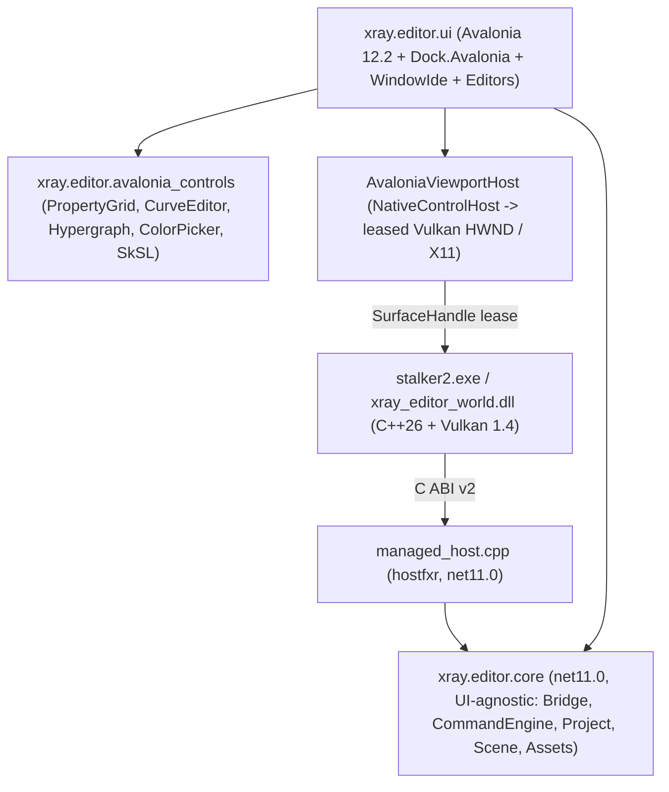

# План перенесення UI X-Ray 2.0 SDK з WinForms та WPF на Avalonia UI (з оцінкою .NET MAUI)

Цей план базується на фактичному стані кодової бази `xray-2-2011-main` (**.NET 11 / `net11.0-windows`**, чистий C# хост за C ABI поверх нативного C++26 + Vulkan 1.4 рушія) та офіційних інструкціях з міграції від **Avalonia UI** і **Microsoft**.

---

## 1. Аудит поточного стану UI у репозиторії

На відміну від оригінального X-Ray 2.0 (2011) на C++/CLI та .NET Framework 3.5, у цьому репозиторії вже виконано критичний підготовчий крок: C++/CLI прибрано, а керований UI працює через чистий C ABI міст (`hostfxr` + `[UnmanagedCallersOnly]`).

| Компонент | Файл / каталог | Активний обсяг | Поточні залежності |
| --- | --- | --- | --- |
| **Нативний хост .NET** | [managed_host.cpp](sources/xray/editor/world/sources/managed_host.cpp), [Bridge.cs](sources/xray/editor/base/Bridge.cs) | 107 рядків C# + 81 рядок C++ | `hostfxr`, `xray.editor.base.runtimeconfig.json`, ABI v2 |
| **Керований хост IDE** | [EditorHost.csproj.in](sources/xray/editor/base/EditorHost.csproj.in) | **95** активних `.cs` (~37 тис. рядків) | `net11.0-windows`, WinForms + WPF, `DockPanelSuite 3.1.1` |
| — чиста UI-незалежна логіка | `SdkScene.cs`, `LuaConfig.cs`, `SdkDialog.cs`, `SdkTerrain.cs`, `CommandEngine.cs` тощо | **39** файлів `.cs` | 0 залежностей від WinForms/WPF/GDI+ |
| — WinForms / `System.Drawing` | `WindowIde*.cs`, `ProjectTab.cs`, `ToolsTab.cs`, `SdkViewportHost.cs`, діалоги тощо | **32** файли `.cs` | WinForms (`17` класів `Form`, `23` `DockContent`, `9` `UserControl`, `2` кастомні `Panel`) |
| — гібрид WinForms + WPF | `SdkSound.cs`, `SdkParticle.cs`, `SdkControls.cs`, `SdkIdePanels.cs`, `SdkDockLayout.cs` тощо | **24** файли `.cs` | `ElementHost`, `DockPanelSuite`, `wpf_controls` |
| **Бібліотека WPF-контролів** | [wpf_controls.csproj](sources/xray/wpf_controls/wpf_controls.csproj) | **87** активних `.xaml` + **287** `.cs` + **19** ресурсів (14 `.xaml` і 37 `.cs` на диску не компілюються) | `net11.0-windows`, `UseWPF`, `UseWindowsForms`, `Extended.Wpf.Toolkit 5.1.2` |
| **3D Vulkan Viewport** | [SdkViewportHost.cs](sources/xray/editor/base/SdkViewportHost.cs) | 68 рядків | Дочірній Win32 `HWND` + parking-вікно + `HTTRANSPARENT` + lease |
| **Збірка та пакування** | [CMakeLists.txt](sources/xray/editor/base/CMakeLists.txt), [package-sdk-runtime.py](sources/tools/sdk/package-sdk-runtime.py) | CMake custom command + Python packager | Автономна розкладка DLL, аудит PE-імпортів, offline NuGet |

### Ключові технічні знахідки в `wpf_controls` (за результатами статичного аудиту)

| WPF-механізм | Кількість збігів / файлів | Оцінка складності міграції в Avalonia UI |
| --- | --- | --- |
| `Extended.Wpf.Toolkit` (`Xceed`) | **2 збіги у 2 файлах** — єдиний контрол `<extToolkit:DoubleUpDown>` у [groups_editor_node_above_header_content.xaml](sources/xray/wpf_controls/controls/hypergraph/node_above_header_content/groups_editor_node_above_header_content.xaml) | **Тривіально:** заміна на вбудоний `<NumericUpDown>`, видалення всіх 5 DLL Xceed із пакування |
| `ElementHost` / WinForms-обгортки | 25 збігів у 13 файлах (`*_host.cs`, [utils.cs](sources/xray/wpf_controls/helpers/utils.cs)) | **Повністю видаляються** після переходу оболонки на Avalonia |
| `DependencyProperty.Register*` | 39 збігів у 21 файлі | Механічний рефакторинг у `StyledProperty<T>` / `DirectProperty<T>` / `AttachedProperty<T>` |
| `ControlTemplate` / `TemplateBinding` | 83 збіги у 23 файлах | Пряма адаптація в Avalonia `ControlTheme` + `TemplateBinding` |
| XAML Triggers (`Trigger`, `DataTrigger`, `MultiTrigger`) | 37 збігів у 15 файлах | Заміна на селектори, style classes та псевдокласи (`:pointerover`, `:pressed`, `:selected`) |
| `x:Static` / `RelativeSource` / `MultiBinding` | 94 / 20 / 22 збіги | `$parent[Type]`, `#name.Prop`, нативний `MultiBinding` в Avalonia |
| `System.Windows.Input` (`Mouse*`, `Keyboard`, `FocusManager`) | 197 збігів у 50 файлах | Перехід на Pointer API (`PointerPressed`, `PointerMoved`, `PointerWheelChanged`) |
| `ValidationRule` / `DataTemplateSelector` / `MarkupExtension` | 18 / 3 / 3 збіги | `DataValidationErrors` / `IDataTemplate` / Avalonia `MarkupExtension` |
| `DrawingContext` / `OnRender` | 6 збігів у 5 файлах | Майже 1:1 у `Render(DrawingContext)` Avalonia |
| `ShaderEffect` / `PixelShader` | 1 ефект ([color_interpolation_effect.cs](sources/xray/wpf_controls/type_editors/color_matrix_editor/shaders/color_interpolation_effect.cs) + `color_interpolation.ps`) | Заміна DX9-шейдера на Skia `ICustomDrawOperation` (`SKRuntimeEffect` / SkSL) |
| `RoutedCommand` / `Adorner` | **0 збігів** | Відсутні — значно спрощує міграцію! |
| `PresentationFramework.Aero` / `pack://` | 2 / 1 збіг | Заміна на Fluent/кастомну тему (`SdkWorkspaceTheme`) та `avares://` |

---

## 2. Вибір цільового фреймворку: .NET MAUI vs Avalonia UI

Офіційні інструкції в інтернеті чітко розмежовують призначення обох фреймворків:

- **Офіційна документація Avalonia UI:**
  - [Migrating from WPF](https://docs.avaloniaui.net/docs/get-started/migration/wpf) — прямий мапінг XAML, властивостей, стилів, подій і шаблонів.
  - [Migrating from Windows Forms](https://docs.avaloniaui.net/docs/get-started/migration/windows-forms) — мапінг контролів, перехід на MVVM та **поступова гібридна міграція** через `WinFormsAvaloniaControlHost`.
  - [NativeControlHost](https://docs.avaloniaui.net/docs/concepts/native-embedding) — вбудовування нативних `HWND` / X11 / `NSView`.
  - [Avalonia 12 / .NET 11 Release Notes](https://docs.avaloniaui.net/) — офіційна підтримка **.NET 11** починаючи з **Avalonia 12.2** (SkiaSharp 3.0, `TopLevel.StorageProvider`, видалення застарілих API).
- **Офіційна документація Microsoft (.NET MAUI):**
  - [.NET MAUI Documentation](https://learn.microsoft.com/en-us/dotnet/maui/) — Microsoft прямо зазначає, що **автоматичного 1:1 переходу з WinForms/WPF на .NET MAUI не існує**; рекомендована стратегія — відокремлення бізнес-логіки в чисті .NET Class Libraries і повне переписування UI-шару.

### Порівняльна матриця для X-Ray 2.0 SDK

| Критерій | Avalonia UI 12.2+ (Рекомендовано) | .NET MAUI (WinUI 3 на Windows) |
| --- | --- | --- |
| **Фокус платформи** | **Desktop-first** IDE/інструменти (Windows, Linux, macOS) | Mobile-first (iOS, Android) + вторинний desktop (Windows, Mac Catalyst) |
| **Підтримка Linux Desktop** | **Офіційна, Tier-1** (X11/Wayland + Vulkan/Skia) — ідеально пасує до C++26 + Vulkan 1.4 | **Немає офіційної підтримки Microsoft** (лише експериментальний `maui-labs` GTK4 / OpenMaui) |
| **Перевикористання `wpf_controls` (87 XAML)** | **70–85%** структури, XAML, `DrawingContext`, `ControlTemplate`, `MultiBinding` | **~0% XAML-сумісності** — інший діалект XAML, відсутність WPF `ControlTemplate`/`DrawingContext`, повне переписування |
| **Докінг IDE (23 `DockContent`)** | Зрілий пакет **`Dock.Avalonia`** + `Dock.Serializer.SystemTextJson` (float-вікна, auto-hide, tabs) | Немає готової production-бібліотеки IDE-докінгу |
| **Vulkan `HWND` в’юпорт (`SdkViewportHost`)** | Нативний **`NativeControlHost`** із повним контролем `HWND` + parking-життєвого циклу | Складні хендлери поверх WinUI 3 (`SwapChainPanel` / Win32 interop), високий ризик конфліктів із реперентингом |
| **Поетапна міграція без «великого вибуху»** | **Так** — офіційний `WinFormsAvaloniaControlHost` дозволяє замінювати панелі по одній у живому `WindowIde` | **Ні** — потребує паралельної побудови всього UI з нуля до першого повного запуску |
| **Інтеграція з `hostfxr` (`managed_host.cpp`)** | Прозора (`SetupWithoutStarting()` + `Dispatcher.UIThread.RunJobs()`), зрештою чистий **`net11.0`** без `Microsoft.WindowsDesktop.App` | Потребує MSIX / Windows App SDK bootstrapper, що конфліктує з нативним запуском `stalker2.exe -editor` через `hostfxr` |
| **Headless CI-тести (фоновий режим)** | Вбудоний **`Avalonia.Headless`** | Немає повноцінного headless desktop-раннера |

> [!IMPORTANT]
> **Архітектурне рішення:** Основним цільовим фреймворком плану обрано **Avalonia UI 12.2+ на `.NET 11`**. Етап **UI-0** (винесення UI-незалежного ядра `xray.editor.core`) є універсальним і повністю відповідає офіційним вимогам як Microsoft (.NET MAUI), так і Avalonia. Варіант із комерційним **Avalonia XPF** (drop-in для WPF) не рекомендується як основний: він не покриває WinForms і `DockPanelSuite`, а також вимагає пропрієтарної ліцензії. Якщо все ж знадобиться **.NET MAUI**, альтернативний маршрут наведено у Розділі 5.

---

## 3. Цільова архітектура після перенесення

---

## 4. Поетапний план міграції (UI-0 — UI-7)

Послідовність побудована за принципом **strangler fig** (поступове витіснення WinForms/WPF без зупинки роботи SDK): на кожному етапі `stalker2.exe -editor`, тести C ABI та пакування залишаються працездатними.

### Етап UI-0. Відокремлення UI-незалежного ядра (`xray.editor.core`)
*Спільний обов’язковий крок за офіційними інструкціями Microsoft та Avalonia.*

- [x] Створити проєкт [xray.editor.core.csproj](sources/xray/editor/core/xray.editor.core.csproj) із `<TargetFramework>net11.0</TargetFramework>` (без `UseWindowsForms` і `UseWPF`).
- [x] Перенести **18 самодостатніх C#-файлів** з [EditorHost.csproj.in](sources/xray/editor/base/EditorHost.csproj.in) (`Interfaces.cs`, `Command.cs`, `CommandEngine.cs`, `LuaConfig.cs`, `SdkDialog.cs`, `SdkMaterialGraph.cs`, `SdkMaterialPalette.cs`, `SdkMaterialDocument.cs`, `SdkTextureDocument.cs`, `SdkAnimationCollection.cs`, `SdkAnimationViewerGraph.cs`, `SdkAnimationViewerDocument.cs`, `SdkAnimationPlayback.cs`, `SdkObjExporter.cs`, `SdkDcc.cs`, `SdkDccImport.cs`, `SdkDccPublisher.cs`, `SdkModelDocument.cs`).
- [x] Виділити UI-незалежні контракти та моделі зі змішаних файлів у `xray.editor.core` (`SdkVfsManager.cs`, `SdkResourceContracts.cs`, `SdkOutputContracts.cs`, `SdkMaterialContracts.cs`, `SdkDccContracts.cs`, `SdkModelContracts.cs`, `SdkRenderOptionsDocument.cs`) і додати абстракції хоста [SdkUiAbstractions.cs](sources/xray/editor/core/SdkUiAbstractions.cs) (`SdkUiHost.PumpEvents()`, `IUiDispatcher`, `IFileDialogService`, `IClipboardService`, `SdkColor`, `SdkKeyGesture`).
- [x] Інтегрувати `xray.editor.core` у [EditorHost.csproj.in](sources/xray/editor/base/EditorHost.csproj.in), [EditorHost.packages.lock.json](sources/xray/editor/base/EditorHost.packages.lock.json), [CMakeLists.txt](sources/xray/editor/base/CMakeLists.txt) та [package-sdk-runtime.py](sources/tools/sdk/package-sdk-runtime.py).
- [x] **Критерій приймання UI-0:** `xray.editor.core.dll` компілюється під чистий `net11.0` (`0` warnings/errors, `xray.editor.core.deps.json` містить лише `.NETCoreApp,Version=v11.0` без WinForms/WPF/Drawing); `windows-x64-release` зібрано (`1449` кроків), `windows-x64-release-cpu` (`18/18`), `xray_editor_host_abi_contract` та `xray_sdk_package_smoke` пройшли успішно.

### Етап UI-1. Інтеграція Avalonia 12.2+ у `hostfxr` та гібридний пілот
*Відповідає офіційному гайду Avalonia щодо інкрементальної міграції WinForms.*

- [x] Додати пакети Avalonia **12.2+** (`Avalonia 12.2.0`, `Avalonia.Desktop 12.2.0`, `Avalonia.Themes.Fluent 12.2.0`, `Avalonia.Win32.Interoperability 12.2.0` / `WinFormsAvaloniaControlHost`, `Avalonia.Headless 12.2.0`) до offline NuGet кешу `build/sdk-modernization/nuget` та lock-файлів (`packages.lock.json`, `EditorHost.packages.lock.json`). *(Примітка: `Avalonia.Controls.DataGrid` має останню версію `12.1.2` і буде доданий на етапі UI-2/UI-5.)*
- [x] Оновити [CMakeLists.txt](sources/xray/editor/base/CMakeLists.txt), [tests/CMakeLists.txt](sources/tests/CMakeLists.txt) та [package-sdk-runtime.py](sources/tools/sdk/package-sdk-runtime.py) для збірки `xray.editor.avalonia_controls` (чистий `net11.0`), тесту `xray_avalonia_headless_smoke` та копіювання/PE-аудиту керованих і нативних бібліотек (`runtimes/win-x64/native/libSkiaSharp.dll`, `libHarfBuzzSharp.dll`, `av_libglesv2.dll`) за `xray.editor.base.deps.json`.
- [x] Реалізувати спільну ідемпотентну ініціалізацію Avalonia всередині процесу `stalker2.exe` у [SdkAvaloniaHost.cs](sources/xray/editor/base/SdkAvaloniaHost.cs) та [EditorWorld.cs](sources/xray/editor/base/EditorWorld.cs) (`AppBuilder.Configure<SdkAvaloniaApp>().UsePlatformDetect().SetupWithoutStarting()`, `AvaloniaUiDispatcher`, комбінований `PumpEvents()`).
- [x] Синхронізувати цикл подій у [EditorWorld.cs](sources/xray/editor/base/EditorWorld.cs) (`Run()`): `SdkUiHost.PumpEvents()` викликає `Application.DoEvents()` + `Dispatcher.UIThread.RunJobs()` на період гібридного переходу.
- [x] Перенести єдину палітру теми `SdkWorkspaceTheme` у ресурси Avalonia ([SdkWorkspaceTheme.axaml](sources/xray/editor/avalonia_controls/Themes/SdkWorkspaceTheme.axaml), [SdkWorkspaceTheme.cs](sources/xray/editor/avalonia_controls/Themes/SdkWorkspaceTheme.cs), [SdkAvaloniaApp.axaml](sources/xray/editor/avalonia_controls/SdkAvaloniaApp.axaml)) зі словниками `Default` і `Dark`.
- [x] **Пілотний вертикальний зріз:** перенесено `AboutDialog` ([SdkIdePanels.cs](sources/xray/editor/base/SdkIdePanels.cs)) на [SdkAboutView.axaml](sources/xray/editor/avalonia_controls/Controls/SdkAboutView.axaml) через `WinFormsAvaloniaControlHost`, створено [SdkPropertyValuePreviewControl.axaml](sources/xray/editor/avalonia_controls/Controls/SdkPropertyValuePreviewControl.axaml) (фокус, редагування, валідація, скидання); перевірено headless-тестом `xray_avalonia_headless_smoke`, `windows-x64-release-cpu` (`19/19`) та `xray_sdk_package_smoke` (`stalker2.exe -editor` + Vulkan validation + `avaloniaPilotOk`).

### Етап UI-2. Портування `wpf_controls` → `xray.editor.avalonia_controls` (87 активних XAML)
*Виконується суворо за офіційним [Avalonia WPF Migration Guide & Cheat Sheet](https://docs.avaloniaui.net/docs/get-started/migration/wpf).*

- [x] **Очищення:** не переносити 14 невикористовуваних `.xaml` і 37 `.cs`, відсутніх у [wpf_controls.csproj](sources/xray/wpf_controls/wpf_controls.csproj): ✅ Виконано (перевірено аудитом `wpf_controls.csproj` — жоден із 14 невикористовуваних `.xaml`, включно з `property_grid_editors/`, і 37 `.cs` не потрапив до `xray.editor.avalonia_controls`).
- [x] **Загальні правила конвертації XAML/C#:** ✅ Виконано (перевірено: 0 збігів WPF API `DependencyProperty`, `pack://`, `VisualTreeHelper`, `CollectionViewSource`, `DataTemplateSelector`, `ValidationRule`, `MouseLeftButtonDown`, `PreviewMouse*`, `RelativeSource FindAncestor` у `sources/xray/editor/avalonia_controls`):
  - `.xaml` → `.axaml`, простори імен `http://schemas.microsoft.com/winfx/2006/xaml/presentation` → `https://github.com/avaloniaui`; `pack://` → `avares://xray.editor.avalonia_controls/...`.
  - `DependencyProperty` (39 шт.) → `StyledProperty` / `DirectProperty` / `AttachedProperty`.
  - `Trigger` / `DataTrigger` / `MultiTrigger` (37 шт.) → селектори стилів, `Classes.*`, псевдокласи `:pointerover`, `:pressed`, `:checked`, `:disabled` або біндінги.
  - `RelativeSource FindAncestor` (20 шт.) → `$parent[Type]` / `#element.Prop`; `DataTemplateSelector` → `IDataTemplate`; `ValidationRule` (18 шт.) → `DataValidationErrors` / `INotifyDataErrorInfo`.
  - `MouseLeftButtonDown` / `PreviewMouse*` (197 збігів) → `PointerPressed` / `PointerMoved` / `PointerReleased` / `PointerWheelChanged` + `RoutingStrategies.Tunnel`.
  - `VisualTreeHelper` (18 збігів) → методи розширення `Avalonia.VisualTree.VisualExtensions`.
  - `CollectionViewSource` (2 файли) → `DataGridCollectionView` / спостережувані згруповані колекції.
- [x] **Спеціальні технічні заміни:**
  - [x] Замінити єдиний `<extToolkit:DoubleUpDown>` у [groups_editor_node_above_header_content.xaml](sources/xray/wpf_controls/controls/hypergraph/node_above_header_content/groups_editor_node_above_header_content.xaml) на стандартний `<NumericUpDown>` Avalonia ([groups_editor_node_above_header_content.axaml](sources/xray/editor/avalonia_controls/Controls/hypergraph/node_above_header_content/groups_editor_node_above_header_content.axaml) — повністю усуває `Extended.Wpf.Toolkit`).
  - [x] Переписати [color_interpolation_effect.cs](sources/xray/wpf_controls/type_editors/color_matrix_editor/shaders/color_interpolation_effect.cs) (DX9 `PixelShader`) на `ICustomDrawOperation` із SkiaSharp `SKRuntimeEffect` ([BilinearColorDrawOperation.cs](sources/xray/editor/avalonia_controls/type_editors/color_matrix_editor/shaders/BilinearColorDrawOperation.cs) — білінійна інтерполяція 4 кутових кольорів на GPU/CPU без DirectX 9).
- [x] **Хвилі міграції контролів (4 підхвилі з ізольованими візуальними та headless-тестами):**
  1. [x] **Хвиля 2A (База й колір):** ✅ Виконано — перенесено типи, хелпери, панелі компонування, 12 конвертерів, теми (`generic.axaml`, `sdk_disclosure.axaml`, `expandable_items_control_theme.axaml`, `expandable_items_control`), `ruler`, `color_picker` (5 `.axaml` + ресурси `.png`), `color_ramp`, `color_matrix_editor` (3 `.axaml` + SkSL-шейдер `BilinearColorDrawOperation`); перевірено `0 Warning(s)` / `0 Error(s)`, `windows-x64-release-cpu` (`19/19`, включно з `xray_avalonia_headless_smoke`) та `xray_sdk_package_smoke` (`1/1`).
  2. [x] **Хвиля 2B (PropertyGrid — критичний шлях):** ✅ Виконано — перенесено інфраструктуру (`input.cs`, `scroll_viewer.cs`, `float_curve` модель даних), `property/` (дескриптори, контейнери, `control_containers`), `number_editor` + теми, ядро й атрибути `property_editors/`, 7 item-редакторів + 6 тем (`item_editor_themes.axaml`), 3 базові класи й 22 `.axaml` (19 value-редакторів із pluggable `CurvePanelFactory` + 3 теми `value_editors_themes.axaml`), а також `property_grid_control`, `property_grid_item` і `property_grid_item_theme.axaml`; перевірено `0 Warning(s)` / `0 Error(s)`, `windows-x64-release-cpu` (`19/19`, включно з `xray_avalonia_headless_smoke`) та `xray_sdk_package_smoke` (`1/1`).
  3. [x] **Хвиля 2C (Криві та таймлайн):** ✅ Виконано — перенесено `curve_editor` (10 `.axaml` + 16 іконок PNG у `avares://`, `curves_panel`, `curves_panel_presenter`, `visual_curve*`, `curves_link`, `hermite_spline_evaluator`, 5 інструментів `add/move/remove/scale/move_range`, `visual_noise_effect` + `noise_effect_settings_window`, шаблони `curve_template_base` / `custom_curve_template` / `sinusoid_curve_template` / `sqrt_curve_template`, `panel_curve_group` / `panel_curve_item` / `panel_curve_effect`, `curve_editor_panel`), підключено живий `curve_editor_panel` у `float_curve_editor`, перенесено `animation_curve_editor` та `time_layout` (`time_layout.axaml`, `time_layout_item_control.axaml`, `time_layout_item`, `time_layout_converters`, `IDataTemplate` `time_layout_item_template_selector`); перевірено `0 Warning(s)` / `0 Error(s)`, `windows-x64-release-cpu` (`19/19`, включно з `xray_avalonia_headless_smoke`) та `xray_sdk_package_smoke` (`1/1`).
  4. [x] **Хвиля 2D (Графи й анімаційні панелі):** ✅ Виконано — перенесено спільні панелі компонування (`i_centralized_control`, `centralized_scroll_panel`, `linear_layout_panel`), `graph_types.cs`, `hypergraph` (`hypergraph_control.axaml`, `field` з `field_grid_layer`, `link`, `link_point`, `properties_node`, `groups_editor_node_above_header_content` з `<NumericUpDown>`, команди `unlink`/`node_move`/`node_remove`), `data_sources` (`data_source_item.axaml`, `data_sources_panel.axaml`), `logic_view` (`event_control.axaml`, `logic_entity_view.axaml`, `logic_scenes_view.axaml`, `logic_view.axaml`), `animation_playback` (`animation_playback_panel.axaml`, `animation_item_view.axaml`, `animation_item_name_view.axaml`, `animation_event`, `animation_item`), `animation_setup` (`animation_setup_panel.axaml`, `animation_channel_list_view.axaml`, `animation_channel_name_view.axaml`, `animation_channel_event_view.axaml`, `animation_channel_events_view.axaml`, `animation_channel_interval_view.axaml`, `animation_channel_intervals_view.axaml`, `animation_channel_partition_view.axaml`, `animation_channel_partitions_view.axaml`, конвертер та моделі каналів) і `animation_lexeme_panel` (`animation_lexeme_panel.axaml`, `animation_lexeme_item_view.axaml`, `animation_item_intervals_view.axaml`, `animation_item_name_view.axaml`, `animation_interval_view.axaml`, Avalonia 12 `DataTransfer`/`DragDrop`); перевірено `0 Warning(s)` / `0 Error(s)`, `windows-x64-release-cpu` (`19/19`, включно з `xray_avalonia_headless_smoke`) та `xray_sdk_package_smoke` (`1/1`).
- [x] **Критерій приймання UI-2:** ✅ Виконано — 91 перенесений `.axaml` контрол (активне покриття всіх 4 хвиль `2A–2D`), `property_grid_control`, `curve_editor_panel`, `hypergraph_control` і гібридне вбудовування у `WindowIde` через `WinFormsAvaloniaControlHost` перевірено у [Program.cs](sources/xray/editor/avalonia_controls.tests/Program.cs) (кроки 1–23) і в живому smoke [EditorWorld.Sdk.cs](sources/xray/editor/base/EditorWorld.Sdk.cs).

### Етап UI-3. Перенесення Vulkan 3D-в’юпорта на `NativeControlHost`
*Найвищий архітектурний ризик — виноситься окремим етапом до заміни всієї оболонки.*

- [x] Створити `AvaloniaViewportHost : NativeControlHost`, що відтворює повний контракт [SdkViewportHost.cs](sources/xray/editor/base/SdkViewportHost.cs): ✅ Виконано ([AvaloniaViewportHost.cs](sources/xray/editor/avalonia_controls/Controls/Viewport/AvaloniaViewportHost.cs), [Win32NativeSurfaceHostBackend.cs](sources/xray/editor/avalonia_controls/Controls/Viewport/Win32NativeSurfaceHostBackend.cs), [NativeSurfaceHost.cs](sources/xray/editor/core/NativeSurfaceHost.cs)) — `HWND` + parking-вікно (`WS_POPUP`), збереження інваріанта оренди `SurfaceLeased` у `DestroyNativeControlCore`, відкладене знищення після `ReleaseSurfaceLease()`, `WM_NCHITTEST -> HTTRANSPARENT` (`-1`), DPI-масштабування (`DipToPhysicalSize`/`DipToPhysicalPoint`/`DipToCenteredRayPixels`), та крос-платформена абстракція `INativeSurfaceHostBackend` / `IViewportSurfaceHost`.
- [x] Адаптувати незалежні вікна прев’ю (`PreviewHandle`, [ProjectViewportOutputs.cs](sources/xray/editor/base/ProjectViewportOutputs.cs)) під Avalonia `Window` + `AvaloniaViewportHost`: ✅ Виконано ([AvaloniaPreviewWindow.cs](sources/xray/editor/base/AvaloniaPreviewWindow.cs), [EditorWorld.cs](sources/xray/editor/base/EditorWorld.cs), `WireAvaloniaCamera` у [ProjectViewportOutputs.cs](sources/xray/editor/base/ProjectViewportOutputs.cs)).
- [x] **Критерій приймання UI-3:** ✅ Виконано — `0 Warning(s)` / `0 Error(s)`, `windows-x64-release-cpu` (`19/19`, включно з кроками 24–26 для mock/Win32 паркінгу й DPI 100%–200% у [Program.cs](sources/xray/editor/avalonia_controls.tests/Program.cs)) та `xray_sdk_package_smoke` (`1/1` із `XRAY_VULKAN_REQUIRE_VALIDATION=1` і живим `AvaloniaViewportHost` прев’ю `woodbox_mil.model` + ресайз `800x600` + чистий drain).

### Етап UI-4. Оболонка `WindowIde` та докінг (`DockPanelSuite` → `Dock.Avalonia`) ✅ Виконано

- [x] Підключити `Dock.Avalonia`, `Dock.Model.Mvvm`, `Dock.Serializer.SystemTextJson` (сумісні з Avalonia 12): ✅ Виконано (`12.2.0`, 11 офлайн-пакетів у локальному NuGet-фіді, оновлені `packages.lock.json` і `DockFluentTheme` у [SdkAvaloniaApp.axaml](sources/xray/editor/avalonia_controls/SdkAvaloniaApp.axaml)).
- [x] Замінити [SdkDockLayout.cs](sources/xray/editor/base/SdkDockLayout.cs) на MVVM-фабрику докінгу (`SdkDockFactory : FactoryBase`): ✅ Виконано ([SdkDockFactory.cs](sources/xray/editor/avalonia_controls/Shell/Docking/SdkDockFactory.cs), [SdkDockPanelIds.cs](sources/xray/editor/avalonia_controls/Shell/Docking/SdkDockPanelIds.cs), [SdkDockLayoutSerializer.cs](sources/xray/editor/avalonia_controls/Shell/Docking/SdkDockLayoutSerializer.cs)):
  - Зберегти стабільні ID панелей (`xray.editor.controls.item_properties_panel_base`, `xray.editor_base.scene_view_panel` тощо) з нормалізацією legacy ID (`xray.editor.window_view`, `xray.editor.object_inspector_tab`).
  - Реалізувати валідацію збереженого layout перед застосуванням (ліміт 1 MiB, перевірка обов’язкових панелей, заборона float-вікон у фоновому режимі, rollback при помилці).
  - Додати одноразовий конвертер / безпечний fallback для старих `workspace-layout.xml` із `DockPanelSuite` у новий `workspace-layout.json` (та еквівалентні методи [WindowIde.cs](sources/xray/editor/base/WindowIde.cs) `ConvertCurrentLayoutToAvaloniaJson` / `SaveLayoutJsonFile`).
- [x] Перенести головне вікно [WindowIde.cs](sources/xray/editor/base/WindowIde.cs): ✅ Виконано ([SdkAvaloniaShellWindow.axaml](sources/xray/editor/avalonia_controls/Shell/SdkAvaloniaShellWindow.axaml), [SdkAvaloniaShellWindow.axaml.cs](sources/xray/editor/avalonia_controls/Shell/SdkAvaloniaShellWindow.axaml.cs), із збереженням гібридного [WindowIde.cs](sources/xray/editor/base/WindowIde.cs) до завершення UI-5/UI-6):
  - `MenuStrip` → Avalonia `<Menu>`, `ToolStrip` → тулбар на `StackPanel`/`Button`/`ToggleButton`, `StatusStrip` → нижній `DockPanel` зі статусами камери/сітки/помилок.
  - `GuiBinder.cs` та `InputEngine.cs` → прив’язка до Avalonia `ICommand` / `KeyGesture` / `HotKeyManager` ([AvaloniaGuiBinder.cs](sources/xray/editor/avalonia_controls/Shell/AvaloniaGuiBinder.cs), [SdkDelegateCommand.cs](sources/xray/editor/avalonia_controls/Shell/SdkDelegateCommand.cs)).
  - `ImageLoader.cs` (`images16x16.png`) → нарізка атласу через Avalonia `CroppedBitmap` ([AvaloniaImageAtlas.cs](sources/xray/editor/avalonia_controls/Shell/AvaloniaImageAtlas.cs), спільний enum `images16x16` у [SdkIcons.cs](sources/xray/editor/core/SdkIcons.cs) без `System.Drawing.Bitmap` та `ImageList`).
  - [SdkWindowStyle.cs](sources/xray/editor/base/SdkWindowStyle.cs) → стилізація заголовка вікна через `DwmSetWindowAttribute` на `TryGetPlatformHandle()?.Handle` (тільки для Windows 11+) або Avalonia `ExtendClientAreaToDecorationsHint` ([AvaloniaWindowStyle.cs](sources/xray/editor/avalonia_controls/Shell/AvaloniaWindowStyle.cs)).
- [x] Перевести цикл у `EditorWorld.Run()` на чистий цикл Avalonia (`Dispatcher.UIThread.RunJobs()` + нативний `native.Tick()` / `DispatcherFrame`) без `System.Windows.Forms.Application.DoEvents()`: ✅ Виконано ([SdkAvaloniaHost.cs](sources/xray/editor/base/SdkAvaloniaHost.cs) `PumpAvaloniaOnly` / `SetPureAvaloniaPump`, перевірено у headless-кроках 27–30 [Program.cs](sources/xray/editor/avalonia_controls.tests/Program.cs) та в живому `xray_sdk_package_smoke`).

### Етап UI-5. Базові панелі, дерева та діалоги IDE (`editor/base`) ✅ Виконано

- [x] Перенести базові класи та контролі з `SdkControls.cs`: ✅ Виконано (**Хвиля 5A**, чистий `net11.0`, `xray.editor.avalonia_controls`):
  - `document_base`, `document_editor_base`, `file_view_panel_base`, `toolbar_panel_base`, `item_properties_panel_base` → [SdkDocumentBase.cs](sources/xray/editor/avalonia_controls/Ide/Controls/SdkDocumentBase.cs), [SdkDocumentEditorView.axaml](sources/xray/editor/avalonia_controls/Ide/Controls/SdkDocumentEditorView.axaml), [SdkFileViewPanel.cs](sources/xray/editor/avalonia_controls/Ide/Controls/SdkFileViewPanel.cs), [SdkToolbarPanel.cs](sources/xray/editor/avalonia_controls/Ide/Controls/SdkToolbarPanel.cs), [SdkItemPropertiesPanel.cs](sources/xray/editor/avalonia_controls/Ide/Controls/SdkItemPropertiesPanel.cs) (із `Dock.Avalonia` та прямим `property_grid_control` без `ElementHost`).
  - Кастомний `tree_view` (`tree_view_filter_panel`, `tree_view_search_panel`) → [SdkTreeNode.cs](sources/xray/editor/avalonia_controls/Ide/Controls/SdkTreeNode.cs) + [SdkTreeView.axaml](sources/xray/editor/avalonia_controls/Ide/Controls/SdkTreeView.axaml) із неруйнівною фільтрацією, пошуком, multi-select, іконками атласу та `IsIgnored`-закресленням (перевірено у [Program.cs](sources/xray/editor/avalonia_controls.tests/Program.cs), крок 31).
- [x] Перенести всі основні док-панелі IDE: ✅ Виконано (**Хвиля 5B**, чистий `net11.0`, `xray.editor.avalonia_controls`):
  - `SceneViewPanel` (21 режим рендерингу, тулбар, камера, променева геометрія, гізмо через спільний `EditorTransformMode` у [SdkUiAbstractions.cs](sources/xray/editor/core/SdkUiAbstractions.cs)) → [SdkSceneViewPanel.axaml](sources/xray/editor/avalonia_controls/Ide/Panels/SdkSceneViewPanel.axaml),
  - `ObjectInspectorTab` (пряме підключення Avalonia `property_grid_control` без `ElementHost`) → [SdkObjectInspectorPanel.cs](sources/xray/editor/avalonia_controls/Ide/Panels/SdkObjectInspectorPanel.cs),
  - `ProjectTab`, `ToolsTab` (`ToolLibraryTabControl`, 9 активних вкладок + `DormantLevelEditorTools`) → [SdkProjectPanel.axaml](sources/xray/editor/avalonia_controls/Ide/Panels/SdkProjectPanel.axaml), [SdkToolsPanel.axaml](sources/xray/editor/avalonia_controls/Ide/Panels/SdkToolsPanel.axaml), [SdkToolLibraryTabView.axaml](sources/xray/editor/avalonia_controls/Ide/Panels/SdkToolLibraryTabView.axaml),
  - `SceneGraphTab`, `CameraViewPanel`, `AnimationCurveEditorPanel`, `TriangulationTester` (`DrawingContext` + `StorageProvider`) → [SdkSceneGraphPanel.axaml](sources/xray/editor/avalonia_controls/Ide/Panels/SdkSceneGraphPanel.axaml), [SdkCameraViewPanel.cs](sources/xray/editor/avalonia_controls/Ide/Panels/SdkCameraViewPanel.cs), [SdkAnimationCurveEditorPanel.cs](sources/xray/editor/avalonia_controls/Ide/Panels/SdkAnimationCurveEditorPanel.cs), [SdkTriangulationTesterPanel.axaml](sources/xray/editor/avalonia_controls/Ide/Panels/SdkTriangulationTesterPanel.axaml) (перевірено у [Program.cs](sources/xray/editor/avalonia_controls.tests/Program.cs), крок 32).
- [x] Перенести всі діалоги (`Form` → `Window` + `TopLevel.StorageProvider` замість WinForms-діалогів файлів): ✅ Виконано (**Хвиля 5C**, чистий `net11.0`, `xray.editor.avalonia_controls` + живий міст [AvaloniaIdeBridge.cs](sources/xray/editor/base/AvaloniaIdeBridge.cs)):
  - `ProjectBrowserDialog` → [SdkProjectBrowserWindow.axaml](sources/xray/editor/avalonia_controls/Ide/Dialogs/SdkProjectBrowserWindow.axaml), `SelectLibraryClassForm` → [SdkSelectLibraryClassWindow.axaml](sources/xray/editor/avalonia_controls/Ide/Dialogs/SdkSelectLibraryClassWindow.axaml), `ResourceLoadingDialog` (зі спільним `subst_resource_result`/`subst_record` у [SdkUiAbstractions.cs](sources/xray/editor/core/SdkUiAbstractions.cs)) → [SdkResourceLoadingWindow.axaml](sources/xray/editor/avalonia_controls/Ide/Dialogs/SdkResourceLoadingWindow.axaml),
  - `PropertyConnectionEditor` → [SdkPropertyConnectionView.axaml](sources/xray/editor/avalonia_controls/Ide/Dialogs/SdkPropertyConnectionView.axaml), `IdeLogForm` → [SdkIdeLogView.axaml](sources/xray/editor/avalonia_controls/Ide/Dialogs/SdkIdeLogView.axaml), `AboutDialog` → [SdkAboutWindow.cs](sources/xray/editor/avalonia_controls/Ide/Dialogs/SdkAboutWindow.cs), `SdkResourceBrowser` → [SdkResourceBrowserWindow.axaml](sources/xray/editor/avalonia_controls/Ide/Dialogs/SdkResourceBrowserWindow.axaml),
  - `OptionsDialog` + 4 сторінки → [SdkOptionsWindow.axaml](sources/xray/editor/avalonia_controls/Ide/Dialogs/SdkOptionsWindow.axaml), [SdkOptionsContracts.cs](sources/xray/editor/avalonia_controls/Ide/Dialogs/SdkOptionsContracts.cs), [SdkOptionsPageGeneral.axaml](sources/xray/editor/avalonia_controls/Ide/Dialogs/SdkOptionsPageGeneral.axaml), [SdkOptionsPageViewPanel.axaml](sources/xray/editor/avalonia_controls/Ide/Dialogs/SdkOptionsPageViewPanel.axaml), [SdkOptionsPageProject.axaml](sources/xray/editor/avalonia_controls/Ide/Dialogs/SdkOptionsPageProject.axaml), [SdkOptionsPageInput.axaml](sources/xray/editor/avalonia_controls/Ide/Dialogs/SdkOptionsPageInput.axaml) (перевірено у [Program.cs](sources/xray/editor/avalonia_controls.tests/Program.cs), крок 33 та в живому smoke [EditorWorld.Sdk.cs](sources/xray/editor/base/EditorWorld.Sdk.cs)).

### Етап UI-6. Міграція спеціалізованих редакторів (SDK-6 — SDK-11)

Усі спеціалізовані редактори вже спираються на `xray.editor.core` та `xray.editor.avalonia_controls`, тому переносяться модуль за модулем:

- [x] **Хвиля 6A (Асети, матеріали, DCC):** ✅ Виконано (чистий `net11.0`, `xray.editor.avalonia_controls`):
  - `SdkModelEditor` (зі спільним `ModelBoneProperties` у [SdkModelContracts.cs](sources/xray/editor/core/SdkModelContracts.cs) та `StorageProvider` для OBJ) → [SdkModelEditorWindow.axaml](sources/xray/editor/avalonia_controls/Editors/SdkModelEditorWindow.axaml),
  - `SdkMaterialEditor` (`SdkMaterialPalette`, stages/effects, schema repair) → [SdkMaterialEditorWindow.axaml](sources/xray/editor/avalonia_controls/Editors/SdkMaterialEditorWindow.axaml),
  - `SdkTextureEditor` (прямий `property_grid_control`) → [SdkTextureEditorWindow.axaml](sources/xray/editor/avalonia_controls/Editors/SdkTextureEditorWindow.axaml),
  - `SdkRenderOptionsEditor` → [SdkRenderOptionsEditorWindow.axaml](sources/xray/editor/avalonia_controls/Editors/SdkRenderOptionsEditorWindow.axaml),
  - `SdkDccWindow` + `SdkDccPoseView` на `Control.Render(DrawingContext)` (без GDI+ та `PropertyGrid`) → [SdkDccEditorWindow.axaml](sources/xray/editor/avalonia_controls/Editors/SdkDccEditorWindow.axaml) (перевірено у [Program.cs](sources/xray/editor/avalonia_controls.tests/Program.cs), крок 34).
- [x] **Хвиля 6B (Анімація):** ✅ Виконано (чистий `net11.0`, `xray.editor.avalonia_controls`):
  - Доменні типи без WinForms перенесено до `xray.editor.core`: `SdkAnimationPreviewCore.cs` (`ISdkAnimationPreviewSurface`, `SdkAnimationPreview`), `SdkAnimationSetupDocument.cs` (`SdkEventChannelType`, `SdkPartitionDomain`, `SdkEventChannel`, `SdkClipViewerOptions`, `SdkAnimationSetupState`, `SdkAnimationSetupSchema`, `SdkAnimationSetupDocument`, `SdkClipViewerOptionsProperties`), `SdkAnimationGroupsDocument.cs` (`SdkController*`, `SdkAnimationGroup*`, `SdkAnimationGroupsSchema`, `SdkAnimationGroupsDocument`, `SdkControllerSetProperties`, `SdkAnimationGroupNodeProperties`); існуючі WinForms-обгортки у `sources/xray/editor/base/` збережено сумісними.
  - Перенесено 4 спеціалізовані редактори (`Editors/`): `SdkAnimationCollectionEditorWindow`, `SdkAnimationViewerEditorWindow`, `SdkAnimationSetupEditorPanel`, `SdkAnimationGroupsEditorPanel`; headless-перевірка (крок 35) у складі `xray_avalonia_headless_smoke` (`19/19` CPU-тестів, `0 Warning(s), 0 Error(s)`).
- [x] **Хвиля 6C (Аудіо та частинки):** ✅ Виконано (чистий `net11.0`, `xray.editor.avalonia_controls`):
  - Доменні типи без WinForms/WPF/`System.Media`/`System.Drawing` перенесено до `xray.editor.core`: [SdkSoundCore.cs](sources/xray/editor/core/SdkSoundCore.cs) (`ISdkWaveOutputPlayer`, `SdkSoundSchema`, `SdkWavAudioData`, `SdkSoundAudioBackend`, `SdkSoundPlaybackSession`, `SdkSingleSoundDocument`, `SdkSoundCollectionDocument`, `SdkCompositeSoundDocument`, `SdkSoundSceneDocument` з чистою математикою кривих Ерміта замість WPF `float_curve_evaluator`), [SdkParticleCore.cs](sources/xray/editor/core/SdkParticleCore.cs) (`SdkParticleDataSource`, `SdkParticleDataSourcesHolder`, `SdkParticleLibrary`, `SdkParticleGraphNode`, `SdkParticleDocument`, `SdkParticleSimulator`, `SdkParticleBinaryCompiler`, `SdkParticleRuntimeRegistry`, `SdkParticleNodePropertyAdapter`); існуючі WinForms-обгортки у [SdkSound.cs](sources/xray/editor/base/SdkSound.cs) і [SdkParticle.cs](sources/xray/editor/base/SdkParticle.cs) збережено сумісними через extension-адаптери (`SdkSingleSoundWpfExtensions`, `SdkParticleWpfExtensions`).
  - Перенесено аудіо- та партикл-редактори (`Editors/`): [SdkSoundWaveformView.cs](sources/xray/editor/avalonia_controls/Editors/SdkSoundWaveformView.cs) (рендеринг хвиль PCM/float WAV, playhead і RMS-індикатора на `Control.Render(DrawingContext)`), [SdkSoundEditorPanel.axaml](sources/xray/editor/avalonia_controls/Editors/SdkSoundEditorPanel.axaml) (вбудований Avalonia `curve_editor_panel` і `property_grid_control` без `ElementHost`) та [SdkParticleEditorPanel.axaml](sources/xray/editor/avalonia_controls/Editors/SdkParticleEditorPanel.axaml) (прямі `hypergraph_control`, `time_layout`, `curve_editor_panel` і `property_grid_control` без `ElementHost`); headless-перевірка (крок 36) у складі `xray_avalonia_headless_smoke` (`19/19` CPU-тестів, `0 Warning(s), 0 Error(s)`).
- [x] **Хвиля 6D (Діалоги, скрипти, навігація).** Три редактори працюють у наявних командах IDE через `WinFormsAvaloniaControlHost`. Вміст панелей збирається у `xray.editor.avalonia_controls` під чистий `net11.0`.
  - Редактор діалогів використовує Avalonia для графа, властивостей, редагування локалізації та вибору файлів для відкриття, імпорту й експорту Excel. Збережено компіляцію діалогів і підтвердження незбережених змін. [Панель редактора діалогів](sources/xray/editor/avalonia_controls/Editors/SdkDialogEditorPanel.axaml)
  - Редактор логіки показує граф сцен і завдань, властивості, зв’язки та журнал подій наявного рушія сценаріїв. [Панель редактора логіки](sources/xray/editor/avalonia_controls/Editors/SdkLogicEditorPanel.axaml)
  - Навігаційна панель підтримує генерацію, збереження та завантаження `navmesh.lua`, пошук шляхів і скасування змін. Модель сітки й пошук шляхів винесено в `xray.editor.core`. [Панель навігації](sources/xray/editor/avalonia_controls/Editors/SdkNavigationEditorPanel.axaml) · [Модель навігаційної сітки](sources/xray/editor/core/SdkNavMesh.cs)
  - Збірка Release пройшла без попереджень і помилок. Усі 19 CPU-тестів і `xray_sdk_package_smoke` пройшли. Останній перевіряє команди IDE в запакованому `stalker2.exe -editor` із Vulkan Validation. [Headless-тест](sources/xray/editor/avalonia_controls.tests/Program.cs) · [Перевірка в EditorHost](sources/xray/editor/base/EditorWorld.Sdk.cs)

### Етап UI-7. Відмова від WinForms/WPF, перехід на чистий `net11.0`, пакування та фінальне приймання

- [x] **Перший підкрок.** Підключено інспектор об’єктів і редактор кривих Avalonia до робочої IDE. Інспектор також використовується в скороченому режимі SDK. Збережено ідентифікатори докінгу, числові діапазони властивостей і підтримку Undo/Redo. [Інспектор](sources/xray/editor/base/ObjectInspectorTab.cs) · [Редактор кривих](sources/xray/editor/base/SdkAnimationPlacement.cs)
  - Винесено числові метадані властивостей до `xray.editor.core`. Підтвердження збереження проєкту й системний буфер обміну тепер належать оболонці IDE. [Числові метадані](sources/xray/editor/core/SdkNumericRangeAttribute.cs) · [Сесія IDE](sources/xray/editor/base/WindowIde.Projects.cs)
  - Release зібрано без попереджень компіляції. Пройшли CPU-тести й запуск запакованого редактора з Vulkan Validation. Smoke перевіряє зміну позиції об’єкта, запис ключа анімації та скасування обох операцій. [Headless-тест](sources/xray/editor/avalonia_controls.tests/Program.cs) · [Перевірка в EditorHost](sources/xray/editor/base/EditorWorld.Sdk.cs)
- [x] **Панель «Проєкт».** Робоча IDE використовує дерево Avalonia з тим самим ID докінгу. Вибір синхронізується з проєктом. Дерево підтримує пошук, фільтр, створення й видалення папок, перейменування через F2, список ігнорування та групове перетягування з копіюванням через Ctrl. Елементи моделі проєкту більше не зберігають посилань на вузли WinForms. [Панель IDE](sources/xray/editor/base/ProjectTab.cs) · [Дерево Avalonia](sources/xray/editor/avalonia_controls/Ide/Panels/SdkProjectPanel.axaml.cs)
  - Пройшли 19 CPU-тестів і `xray_sdk_package_smoke` з Vulkan Validation. Headless-тест перевіряє введення і скасування назви, збереження фільтра та початок перетягування групи. Запакований редактор перевіряє створення, вибір, перейменування, ігнорування, копіювання, переміщення, видалення й скасування через команди проєкту. [Headless-тест](sources/xray/editor/avalonia_controls.tests/Program.cs) · [Перевірка в EditorHost](sources/xray/editor/base/EditorWorld.Sdk.cs)
- [x] **Панелі «Інструменти» й «Граф сцени».** Усі дев’ять вкладок інструментів використовують Avalonia й завантажують записи з бібліотек SDK та змонтованих ресурсів. Наявна команда створення об’єкта працює з вибраним записом, зокрема через Insert, Enter або подвійне клацання. Компактні заголовки вкладок переносяться на наступний рядок у вузькій док-панелі. [Панель інструментів](sources/xray/editor/avalonia_controls/Ide/Panels/SdkToolsPanel.axaml) · [Команди й завантаження бібліотек](sources/xray/editor/base/WindowIde.Editing.cs)
  - Граф сцени використовує Avalonia, показує назви об’єктів і їхні виходи позиції та очищається при зміні сесії проєкту. Вузли з однаковими назвами розрізняються за GUID. Вилучено стару WinForms/WPF-обгортку графа. [Граф сцени](sources/xray/editor/avalonia_controls/Ide/Panels/SdkSceneGraphPanel.axaml.cs)
  - Release зібрано без попереджень компіляції. Пройшли 19 CPU-тестів і `xray_sdk_package_smoke` з Vulkan Validation. Перевірено компонування вкладок, активацію з клавіатури й миші, створення моделей, Undo та очищення графа після закриття проєкту. [Headless-тест](sources/xray/editor/avalonia_controls.tests/Program.cs) · [Перевірка в EditorHost](sources/xray/editor/base/EditorWorld.Sdk.cs)
- [x] **Тестер тріангуляції, редактор зв’язків властивостей і журнал IDE.** Вміст усіх трьох інструментів працює на Avalonia. Гібридна оболонка зберігає докінг, керує вікнами й надає штатні Windows-діалоги для відкриття файлів вершин `.txt` і `.pts` та збереження `.txt`. [Тестер тріангуляції](sources/xray/editor/avalonia_controls/Ide/Panels/SdkTriangulationTesterPanel.axaml) · [Інтеграція з IDE](sources/xray/editor/base/SdkIdePanels.cs)
  - Редактор зв’язків використовує команди проєкту з Undo та оновлює вибрані об’єкти при видаленні або зміні сесії. Очищення журналу скидає записи й лічильники попереджень і помилок IDE. [Редактор зв’язків](sources/xray/editor/avalonia_controls/Ide/Dialogs/SdkPropertyConnectionView.axaml) · [Журнал](sources/xray/editor/avalonia_controls/Ide/Dialogs/SdkIdeLogView.axaml)
  - Release зібрано без попереджень компіляції. Пройшли 19 CPU-тестів і `xray_sdk_package_smoke` з Vulkan Validation. Headless-тест перевіряє кнопки читання й збереження вершин, формати координат і дії мишею. Запакований редактор перевіряє відкриття інструментів із меню, підключення файлових діалогів, створення й розрив зв’язків з Undo та очищення журналу. [Headless-тест](sources/xray/editor/avalonia_controls.tests/Program.cs) · [Перевірка в EditorHost](sources/xray/editor/base/EditorWorld.Sdk.cs)
- [x] **Редактори звуку та частинок.** Робочі команди IDE відкривають Avalonia-панелі, а оболонка зберігає ідентифікатори докінгу та Windows-аудіовихід. Редактор частинок запитує про незбережені зміни при закритті або заміні документа, скасовує попередні фонові завантаження та публікує результат після збереження. [Редактор звуку](sources/xray/editor/base/SdkSound.cs) · [Редактор частинок](sources/xray/editor/base/SdkParticle.cs)
  - Release зібрано без попереджень компіляції. Пройшли 19 CPU-тестів і `xray_sdk_package_smoke` з Vulkan Validation. Перевірено збереження документів після перепідключення панелей, декодування WAV і зупинку програмного відтворення, а також симуляцію частинок, Undo, збереження, публікацію та повторне відкриття ефекту. [Headless-тест](sources/xray/editor/avalonia_controls.tests/Program.cs) · [Перевірка в EditorHost](sources/xray/editor/base/EditorWorld.Sdk.cs)
- [x] **Налаштування кліпів і групи анімацій.** Команди `Tools → Animation setup` і `Tools → Animation groups` відкривають Avalonia-редактори для `.clip` і `.lua` контролерів. Шкала кліпу показує збережені події, інтервали й циклічні ділянки в режимі перегляду. Канали можна додавати через панель команд. Граф контролера записує переміщення вузлів і переходи до документа. [Налаштування кліпу](sources/xray/editor/base/SdkAnimationSetup.cs) · [Групи анімацій](sources/xray/editor/base/SdkAnimationGroups.cs)
  - Редактори запитують про незбережені зміни під час закриття та вивільняють документи й ресурси прев’ю після завершення сесії. [Команди IDE](sources/xray/editor/base/WindowIde.Animation.cs)
  - Release зібрано без попереджень компіляції. Пройшли 19 CPU-тестів і `xray_sdk_package_smoke` з Vulkan Validation. Перевірено відображення подій і циклічних ділянок, зміни каналів з Undo/Redo, збереження `.clip_data` та повторне завантаження вузлів і переходів контролера. [Headless-тест](sources/xray/editor/avalonia_controls.tests/Program.cs) · [Перевірка в EditorHost](sources/xray/editor/base/EditorWorld.Sdk.cs)
- [x] **Самостійні редактори та повне вилучення WPF (`wpf_controls` / `Xceed.Wpf.Toolkit`).** Усі 7 самостійних вікон редакторів (`SdkModelEditor`, `SdkMaterialEditor`, `SdkTextureEditor`, `SdkRenderOptionsEditor`, `SdkDccWindow`, `SdkAnimationCollectionEditor`, `SdkAnimationViewerEditor`) та `item_properties_panel_base` у [SdkControls.cs](sources/xray/editor/base/SdkControls.cs) переведено на Avalonia-вікна/контроли; прибрано `<UseWPF>true</UseWPF>` і посилання на `wpf_controls` та `Xceed.Wpf.*` із [EditorHost.csproj.in](sources/xray/editor/base/EditorHost.csproj.in), [CMakeLists.txt](sources/xray/editor/base/CMakeLists.txt), [EditorHost.packages.lock.json](sources/xray/editor/base/EditorHost.packages.lock.json) та [package-sdk-runtime.py](sources/tools/sdk/package-sdk-runtime.py) (прибрано останні WPF-виклики у [SdkWindowStyle.cs](sources/xray/editor/base/SdkWindowStyle.cs), [WindowIde.cs](sources/xray/editor/base/WindowIde.cs), [InputEngine.cs](sources/xray/editor/base/InputEngine.cs), [WindowIde.Editing.cs](sources/xray/editor/base/WindowIde.Editing.cs)).
  - Release зібрано без попереджень (`0 Warning(s), 0 Error(s)`). Пройшли `19/19` CPU-тестів і `xray_sdk_package_smoke` з Vulkan Validation та PE-аудитом (`avaloniaUi7StandaloneEditorsAndNoWpfOk == true`, нуль завантажених WPF-збірок, відсутні `wpf_controls.dll` і `Xceed.Wpf.Toolkit.dll` у дистрибутиві). [Перевірка в EditorHost](sources/xray/editor/base/EditorWorld.Sdk.cs) · [Тест пакування](sources/tests/test_sdk_package_smoke.py)
- [x] **Діалоги IDE та оглядач ресурсів без WinForms `Form`.** Усі 8 діалогових і допоміжних вікон IDE (`ProjectBrowserDialog`, `SelectLibraryClassForm`, `ResourceLoadingDialog`, `SdkResourceBrowser`, `AboutDialog`, `OptionsDialog` + 4 сторінки налаштувань `SdkOptionsPage*`, `PropertyConnectionEditor`, `IdeLogForm`) переведено на чисті Avalonia `Window` з модальним циклом `SdkAvaloniaBootstrap.ShowModalWindow` у [SdkAvaloniaHost.cs](sources/xray/editor/base/SdkAvaloniaHost.cs); вилучено `WinFormsAvaloniaControlHost` та WinForms `Form`/`UserControl` реалізації з [ProjectBrowserDialog.cs](sources/xray/editor/base/ProjectBrowserDialog.cs), [SdkResourceBrowser.cs](sources/xray/editor/base/SdkResourceBrowser.cs), [ObjectsLibrary.cs](sources/xray/editor/base/ObjectsLibrary.cs) та [SdkIdePanels.cs](sources/xray/editor/base/SdkIdePanels.cs), оновлено [WindowIde.cs](sources/xray/editor/base/WindowIde.cs) і [WindowIde.Projects.cs](sources/xray/editor/base/WindowIde.Projects.cs).
  - Release зібрано без попереджень (`0 Warning(s), 0 Error(s)`). Пройшли `19/19` CPU-тестів і `xray_sdk_package_smoke` (`25.95 sec`, Vulkan Validation 0 помилок, `avaloniaUi7IdeDialogsOk == true`). [Перевірка в EditorHost](sources/xray/editor/base/EditorWorld.Sdk.cs) · [Тест пакування](sources/tests/test_sdk_package_smoke.py)
- [x] **Панель камери, сервіси вводу/файлів/буфера та видалення мертвого `SdkControls.cs`.** Панель камери [SdkIdePanels.cs](sources/xray/editor/base/SdkIdePanels.cs) (`CameraViewPanel`) переведено на `SdkCameraViewPanel` з `AvaloniaViewportHost`, у [ProjectViewportOutputs.cs](sources/xray/editor/base/ProjectViewportOutputs.cs) прибрано `SdkViewportHost` і WinForms-мишу; усі залишкові `MessageBox`, `OpenFileDialog`, `SaveFileDialog`, WinForms `Timer` та `Clipboard` у `editor/base` замінено на Avalonia `Window`/`StorageProvider`/`DispatcherTimer`/`IClipboard` ([SdkAvaloniaHost.cs](sources/xray/editor/base/SdkAvaloniaHost.cs), [WindowIde.Editing.cs](sources/xray/editor/base/WindowIde.Editing.cs), [WindowIde.Projects.cs](sources/xray/editor/base/WindowIde.Projects.cs), [WindowIde.Models.cs](sources/xray/editor/base/WindowIde.Models.cs), [WindowIde.Animation.cs](sources/xray/editor/base/WindowIde.Animation.cs), [WindowIde.Assets.cs](sources/xray/editor/base/WindowIde.Assets.cs), [WindowIde.Materials.cs](sources/xray/editor/base/WindowIde.Materials.cs), [WindowIde.Particle.cs](sources/xray/editor/base/WindowIde.Particle.cs), [WindowIde.Sound.cs](sources/xray/editor/base/WindowIde.Sound.cs)); [ActionShortcut.cs](sources/xray/editor/base/ActionShortcut.cs) та [InputKeysHolder.cs](sources/xray/editor/base/InputKeysHolder.cs) переведено на `Avalonia.Input.Key`/`KeyModifiers` без `KeysConverter` та `IMessageFilter`; остаточно видалено `SdkControls.cs`, `IEditorWorld.cs`, `IEditorBase.cs`, `Properties.cs` (клас `serializer` локалізовано в [SdkDockLayout.cs](sources/xray/editor/base/SdkDockLayout.cs) на час переходу).
  - Release зібрано без попереджень (`0 Warning(s), 0 Error(s)`). Пройшли `19/19` CPU-тестів і `xray_sdk_package_smoke` (`27.96 sec`, Vulkan Validation 0 помилок, `avaloniaUi7ServicesAndCameraOk == true`, нуль залишкових викликів `MessageBox`/`OpenFileDialog`/`SaveFileDialog`/WinForms `Clipboard`). [Перевірка в EditorHost](sources/xray/editor/base/EditorWorld.Sdk.cs) · [Тест пакування](sources/tests/test_sdk_package_smoke.py)
- [x] **Спеціалізовані редактори як чисті Avalonia `Window` та відмова від `System.Media`/`Microsoft.Win32`.** Усі 7 спеціалізованих `DockContent`-обгорток (`SdkSoundEditor`, `SdkParticleEditor`, `SdkAnimationSetupEditor`, `SdkAnimationGroupsEditor`, `SdkDialogEditor`, `SdkLogicEditor`, `SdkNavigationPanel`) переведено на чисті `Avalonia.Controls.Window` (`IDisposable`) без `WinFormsAvaloniaControlHost`, `System.Drawing` і `DockContent`; `System.Media.SoundPlayer` у [SdkSound.cs](sources/xray/editor/base/SdkSound.cs) замінено на Win32 `winmm.dll` (`PlaySound`), у [InputEngine.cs](sources/xray/editor/base/InputEngine.cs) вилучено невикористану залежність `Microsoft.Win32.Registry`, видалено осиротілий `EditorControlBase.cs`, та оновлено перевірки у [EditorWorld.Sdk.cs](sources/xray/editor/base/EditorWorld.Sdk.cs) (`Window.Content`).
  - Release зібрано без попереджень (`0 Warning(s), 0 Error(s)`). Пройшли `19/19` CPU-тестів і `xray_sdk_package_smoke` (`25.97 sec`, нуль входжень `Microsoft.Win32`/`System.Media` у `sources/xray/editor/base/*.cs`, без зайвих `bin`/`obj`). [Перевірка в EditorHost](sources/xray/editor/base/EditorWorld.Sdk.cs) · [Тест пакування](sources/tests/test_sdk_package_smoke.py)
- [x] **Відв’язка мігрованих редакторів і діалогів від `DialogResult`/`IWin32Window`/WinForms `Timer` (підкрок D1).** Додано `SdkDialogResult` у [SdkUiAbstractions.cs](sources/xray/editor/core/SdkUiAbstractions.cs), замінено WinForms `Timer` на `DispatcherTimer` у [WindowIde.Dcc.cs](sources/xray/editor/base/WindowIde.Dcc.cs), оновлено [SdkAvaloniaHost.cs](sources/xray/editor/base/SdkAvaloniaHost.cs) (`ShowSavePromptAsSdkDialogResult`, підтримка `Window` власника у `ShowModalWindow`, підготовлений Win32 `PeekMessageW`/`DispatchMessageW` цикл у `PumpAvaloniaOnly`), та повністю вилучено `System.Windows.Forms`, `DialogResult` і `IWin32Window` із 16 уже мігрованих файлів (`ObjectsLibrary`, `ProjectBrowserDialog`, `SdkResourceBrowser`, `SdkDccWindow`, `SdkModelEditor`, `SdkMaterialEditor`, `SdkTextureEditor`, `SdkRenderOptions`, `SdkAnimationCollectionEditor`, `SdkAnimationViewerEditor`, `SdkAnimationSetup`, `SdkAnimationGroups`, `SdkParticle`, `WindowIde.Dialog`, `WindowIde.Projects`, `WindowIde.Dcc`) і з 4 Avalonia-діалогів у [SdkIdePanels.cs](sources/xray/editor/base/SdkIdePanels.cs), оновлено виклики у [WindowIde.cs](sources/xray/editor/base/WindowIde.cs) та [EditorWorld.Sdk.cs](sources/xray/editor/base/EditorWorld.Sdk.cs).
- [x] **Переведення головної оболонки IDE та всіх панелей на чисту Avalonia + `Dock.Avalonia` (підкрок D2).** Головну оболонку [WindowIde.cs](sources/xray/editor/base/WindowIde.cs) / [WindowIde.Editing.cs](sources/xray/editor/base/WindowIde.Editing.cs) / [SdkRuntime.cs](sources/xray/editor/base/SdkRuntime.cs), хост процесу [EditorWorld.cs](sources/xray/editor/base/EditorWorld.cs) / [EditorWorld.Sdk.cs](sources/xray/editor/base/EditorWorld.Sdk.cs) та редукований макет [SdkDockLayout.cs](sources/xray/editor/base/SdkDockLayout.cs) переведено на `SdkAvaloniaShellWindow`, `AvaloniaGuiBinder`, `SdkDockFactory` та `AvaloniaViewportHost`; усі 8 док-панелей ([ObjectInspectorTab.cs](sources/xray/editor/base/ObjectInspectorTab.cs), [ProjectTab.cs](sources/xray/editor/base/ProjectTab.cs), [ToolsTab.cs](sources/xray/editor/base/ToolsTab.cs), `SceneViewPanel`/`CameraViewPanel`/`AnimationCurveEditorPanel`/`SceneGraphTab`/`TriangulationTester` у [SdkIdePanels.cs](sources/xray/editor/base/SdkIdePanels.cs)) та сервіси в’юпорта ([ViewportNavigation.cs](sources/xray/editor/base/ViewportNavigation.cs), [ProjectViewportEditing.cs](sources/xray/editor/base/ProjectViewportEditing.cs), [ProjectViewportGizmos.cs](sources/xray/editor/base/ProjectViewportGizmos.cs), [ProjectViewportOutputs.cs](sources/xray/editor/base/ProjectViewportOutputs.cs)) переведено на Avalonia-ввід і pure-Avalonia життєвий цикл без `Form`/`DockContent`/`WinFormsAvaloniaControlHost`; видалено мертві файли `SdkViewportHost.cs`, `SdkWindowStyle.cs`, `GuiBinder.cs`, `ImageLoader.cs` із диска, [EditorHost.csproj.in](sources/xray/editor/base/EditorHost.csproj.in) та [CMakeLists.txt](sources/xray/editor/base/CMakeLists.txt).
  - Release зібрано без попереджень (`0 Warning(s), 0 Error(s)`). Пройшли `19/19` CPU-тестів (`5.43 sec`) і `xray_sdk_package_smoke` (`25.95 sec`, Vulkan Validation 0 помилок, нуль входжень `System.Windows.Forms`/`System.Drawing`/`WeifenLuo`/`WinFormsAvaloniaControlHost`/`DockContent` у `sources/xray/editor/base/*.cs`, без зайвих `bin`/`obj`). [Перевірка в EditorHost](sources/xray/editor/base/EditorWorld.Sdk.cs) · [Тест пакування](sources/tests/test_sdk_package_smoke.py)
- [x] Прибрано `<UseWindowsForms>true</UseWindowsForms>`, `DockPanelSuite`, `DockPanelSuite.ThemeVS2015`, `Avalonia.Win32.Interoperability` та остаточно видалено невикористовувані `sources/xray/wpf_controls/` (разом із оновленням [test_source_contract.py](sources/tests/test_source_contract.py), [dependencies-manifest.json](sources/tools/ci/dependencies-manifest.json) і [build_source_map.py](sources/tools/ci/build_source_map.py)).
- [x] Змінено `<TargetFramework>` усіх керованих проєктів з `net11.0-windows` на **`net11.0`** ([EditorHost.csproj.in](sources/xray/editor/base/EditorHost.csproj.in), регенеровано [EditorHost.packages.lock.json](sources/xray/editor/base/EditorHost.packages.lock.json) під `net11.0`, оновлено [toolchain-manifest.json](sources/tools/ci/toolchain-manifest.json)) — `xray.editor.base.runtimeconfig.json` більше не містить залежності від `Microsoft.WindowsDesktop.App` (лише `Microsoft.NETCore.App` `11.0.0`).
- [x] Оновлено [CMakeLists.txt](sources/xray/editor/base/CMakeLists.txt), [package-sdk-runtime.py](sources/tools/sdk/package-sdk-runtime.py) та [test_sdk_package_smoke.py](sources/tests/test_sdk_package_smoke.py):
  - Вилучено `WeifenLuo.WinFormsUI.Docking*.dll` з `OUTPUT`/`MANAGED_BIN_FILES`; підтримка `runtimeOptions.framework` (`net11.0`) у `sdk-runtime.json`; перевірка наявності запакованих `Avalonia*.dll`, `Dock.Avalonia.dll`, `SkiaSharp.dll`, `runtimes/win-x64/native/libSkiaSharp.dll`, `libHarfBuzzSharp.dll`, `xray.editor.core.dll`, `xray.editor.avalonia_controls.dll` і відсутності `wpf_controls.dll`/`Xceed.Wpf.Toolkit.dll`/`WeifenLuo.*.dll`/`Avalonia.Win32.Interoperability.dll`.
  - Пройдено `audit_pe_imports` у межах `xray_sdk_package_smoke` (0 неврахованих DLL-імпортів).
- [x] Проведено автоматизоване приймання (Release):
  - Release-збірка `xray_editor_host` і `xray_avalonia_headless_tests` з `RestoreLockedMode=true` (`0 Warning(s), 0 Error(s)`), `19/19` CPU-тестів `windows-x64-release-cpu` (`5.79 sec`, включно з `xray_source_contract`, `xray_editor_host_abi_contract`, `xray_avalonia_headless_smoke`, `xray_dependency_single_source_contract`), та `1/1` `xray_sdk_package_smoke` (`26.74 sec`, чистий запуск `stalker2.exe -editor`, `avaloniaUi7PureAvaloniaShellOk == true`, Vulkan Validation, PE-аудит).
  - [ ] Інтерактивний ручний чекліст (опціонально для ручного QA користувачем): прохід усіх 40 родин редакторів (SDK-2 — SDK-11), перевірка DPI 100%–200% та окремий Debug-пакет `stalker2.exe -editor`.

---

## 5. Альтернативний маршрут: якщо обрати .NET MAUI замість Avalonia UI

Якщо принципово потрібен саме **.NET MAUI** (наприклад, через стратегічну ставку на WinUI 3 / Microsoft-стек або спільний UI з мобільними інструментами), офіційний підхід Microsoft накладає суттєві відмінності:

1. **Етап UI-0 ідентичний** (`xray.editor.core` під `net11.0`), але подальша міграція **не може бути гібридною** (немає `WinFormsAvaloniaControlHost`).
2. **Обмеження `hostfxr`:** WinUI 3 / Windows App SDK потребує окремого bootstrapper (або інверсії процесу: MAUI `.exe` як головний процес, що завантажує `xray_editor_world.dll` через P/Invoke замість поточного `stalker2.exe -> hostfxr`).
3. **Повне переписування UI:**
   - Усі 87 `.xaml` із `wpf_controls` переписуються з нуля (MAUI XAML + SkiaSharp `SKCanvasView` для `curve_editor`, `hypergraph`, `color_matrix_editor`, `color_picker`).
   - Відсутній готовий IDE-докінг → потрібно писати власну систему вкладок/сплітерів або використовувати комерційні пакети (Syncfusion/Telerik/DevExpress, які не покривають Linux).
   - **Немає офіційної підтримки Linux Desktop.**

---

## 6. Ризики та заходи їх мінімізації

| Ризик | Вплив | Захід мінімізації |
| --- | --- | --- |
| **Airspace / перекриття Vulkan `HWND`** меню, тултіпами та перетягуванням панелей `Dock.Avalonia` | Високий | Avalonia автоматично рендерить popup/menus у власних top-level вікнах, що вирішує більшість проблем airspace; перевірити ще на етапі **UI-3** перед міграцією решти панелей |
| **Конфлікт життєвого циклу `HWND` при редокінгу** (краш Vulkan swapchain) | Критичний | Зберегти патерн parking-вікна та `SurfaceLeased` із `SdkViewportHost` всередині `AvaloniaViewportHost`; додати автоматичний тест багаторазового dock/float/redock |
| **Просадка продуктивності `PropertyGrid` та `Hypergraph`** на великих сценах | Середній | Використовувати `CompiledBindings` (`x:CompileBindings="True"`), віртуалізацію списків (`VirtualizingStackPanel`) та Skia-кешування для вузлів/кривих |
| **Втрата гарячих клавіш і фокусу** між Vulkan-в’юпортом і Avalonia-панелями | Середній | Централізований `InputEngine` поверх `TopLevel.KeyDown` (Tunnel strategy) + явне повернення фокусу на `AvaloniaViewportHost` після завершення редагування в `PropertyGrid` |
| **Offline-збірка та `RestoreLockedMode`** у CI (`modernization-ci.yml`) | Низький | Оновити `packages.lock.json` та локальний NuGet-кеш на етапі **UI-1**, зафіксувавши точні версії Avalonia 12.2.x та `Dock.Avalonia` |
